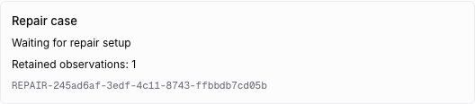
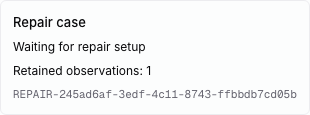
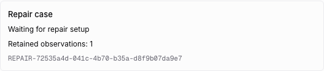
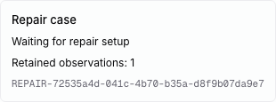

# Independent Admin observation and supervision

The current LoopWork baseline routes role-requested `agent-fault` interventions to
independent Admin management. The source implementation is
`repair-observation-bridge.ts`, `admin-management-store.ts` and
`admin-controller.ts`; the old assistance loop excludes these faults.

## Implemented boundary

The target now has an independent management database at
`<engineering-database>.admin.sqlite`, an Admin-only worker mode and a separate
Go worker client/mutex. Management RPC does not initialize the business database;
each database rejects the other's schema. The Admin database has its own version,
WAL storage and full SQLite synchronization.

A new terminal request freezes the SHA-256 of the actual bundled protocol worker
and the running API executable. These are original runtime facts, rather than the
current checkout HEAD. The immutable original checkpoint and receipt remain in
business storage. Older receipts without these facts are not silently assigned
a newer runtime version and cannot enter this bridge until explicitly reconciled.

The Go bridge reads pending immutable observations, validates their native
workspace/issue/task/agent identity, and sends the original evidence and runtime
versions to management. The native source claim remains in the evidence; a later
claim timestamp does not rewrite the original failure. Closed/Done native issues
are not newly admitted by this increment.

Management persists an observation and its Case in one transaction. A stable
observation ID cannot be reused with changed evidence. Work-item cohort identity
uses the native workspace, issue and chain, retaining different signatures as
separate observations inside one Case. Original summary/version remain unchanged.
An Admin-origin fault must reference an existing Case in the same workspace;
it cannot recursively create an Admin for itself.

Only after management returns the exact Case/cohort does Go acknowledge delivery
against the original business observation ID and checkpoint fingerprint. A separate
business delivery record preserves the terminal receipt unchanged. A crash between
the two stores replays the same observation and reuses the same Case. A second
acknowledgement cannot rebind it. Delivery acknowledgement never resumes the
surrendered issue, spends a rework budget or grants Done.

## Supervision

The API starts a dedicated Admin host loop separately from normal engineering
continuation dispatch. It acquires a 30-second owner/token lease and renews every
10 seconds. Discovery runs independently, so a blocked business read cannot starve
supervision renewal. A concurrent host cannot acquire an unexpired foreign lease.
Expired ownership advances the token; stale renewals, observations and releases
cannot modify the new owner's state. The worker rechecks authority in the same
transaction as observation persistence.

The current intent is initially `stopped`. This increment does not allocate an
investigation process, consume native agent slots or grant process-exit authority.
Lease ownership does not prove that a provider started or stopped. Process identity,
physical-exit confirmation, intent commands and investigation scheduling remain
required before the complete Admin controller is migrated.

## Native visibility

The existing authenticated engineering overview looks up repair status only for
its native workspace/issue. The shared Web/Desktop panel shows the recorded Case,
retained-observation count and waiting-for-setup state. Management unavailability
leaves the original intervention readable and reports repair status as unavailable.
No task credential receives management supervision authority or a management RPC
endpoint. Original investigation evidence remains available on the issue.

## Verification boundary

Store tests cover separate-database rejection, immutable ID replay, cohort retention,
restart, workspace isolation, Admin self-fault linkage and expired supervisor tokens.
The two-store fixture interrupts delivery before acknowledgement and proves replay
without duplicate Case creation or business advancement. A bundled-worker fixture
checks management-only initialization and rejects reversing database roles.

Go tests cover native source validation, interrupted acknowledgement, exact runtime
version projection, unavailable management reads and heartbeat progress while
business discovery is blocked. No provider executable or account is resolved.

Both controlled native browser scenarios passed in 51.8 seconds. Direct and
verification requests reached one acknowledged management Case with exact worker
and API executable fingerprints. The shared UI displayed the retained Case at
1280 and 390 pixels, while ordinary continuation and Done stayed blocked. These
runs used fixture-native tasks and no provider process.

A management host outside the API process, investigation, scoped workspace
takeover, diagnosis, independent repair verification, external dependency probes,
verified business handoff and runtime updates remain unconnected. The complete
migration stays active.
