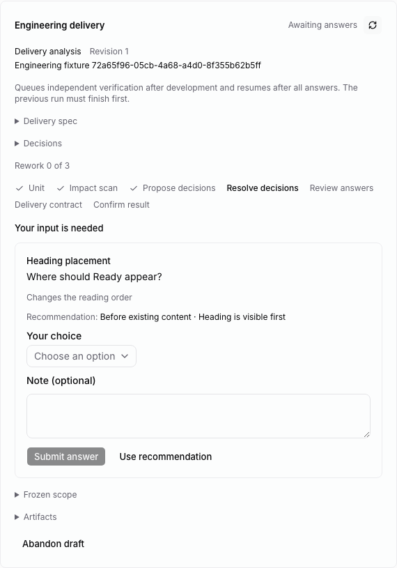
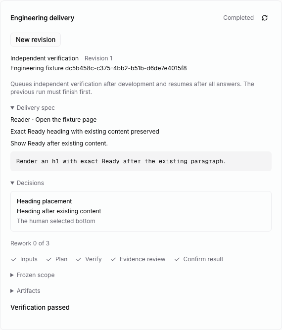
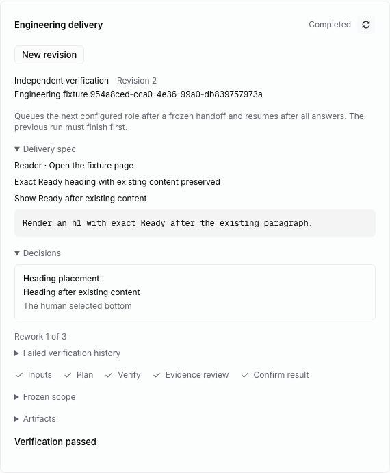

# Delivery analysis

The fork imports LoopWork's `analyst-agent.yaml` into
`packages/command-chain/definitions/analysis.yaml`. It preserves the version-2
authoring structure and seven phases: delivery unit, impact scan, decision
proposal, decision resolution, answer review, delivery contract, and final
confirmation. The existing development/verification profiles remain version 1;
the loader only accepts versions declared by the corresponding host profile.

## Configure a unit

In the shared issue configuration dialog, enable **Include delivery analysis**,
choose a separate analyst, and supply the user, trigger, observable outcome, and
the existing acceptance/oracle scope. Development guidance comes from the
completed analysis rather than a second manual copy. Analysis is optional;
existing configurations retain their development/verification behavior.

The CLI configuration adds these fields to the existing payload:

```json
{
  "analyst_agent_id": "<analyst UUID>",
  "decision_mode": "balanced",
  "unit": {
    "key": "heading",
    "title": "Reader heading",
    "actor": "Reader",
    "trigger": "Open the page",
    "observableOutcome": "The agreed heading appears",
    "acceptance": "Exact Ready heading",
    "sourceRefs": [
      {"key":"ac1","kind":"acceptance","content":"Exact Ready heading","sourceRef":"AC:heading:r1"}
    ],
    "dependsOn": []
  }
}
```

The original payload still supplies the repository, verifier, frozen sources,
optional developer, automatic continuation policy, and any rework budget.
The repository must be clean at configuration. Analysis operations require
their bound clean, frozen Git snapshot, including normalized runtime overlays;
analysis cannot hand off business-file edits as if they were investigation.

For cross-unit prerequisites, list their stable keys in `unit.dependsOn` and
provide `dependency_issues: [{"key":"prior","issue_id":"<UUID>"}]`. Go checks
the human's visibility of those issues. The worker requires a registered current
passed verification in the same workspace and freezes its actual binding. An
untracked issue, self-reference, missing mapping, absent verified commit, or
replacement verification version cannot serve as that frozen prerequisite.
For the same Git repository, the unit's frozen analysis base must include that
verified prerequisite commit. A downstream edit or descendant commit does not
erase the parent's immutable passed-version evidence. Reading that evidence is
separate from the live-checkout check used to permit a new done-status write.
Dependencies are rechecked at run preparation/claim, repository binding,
protocol operations, and completion. These reads and queue/file operations are
separate, not a cross-database transaction. The current form authors a standalone
unit; dependency authoring through native planning/pickers remains pending.

## Decisions and human choice

`multica engineering start/status` returns the frozen unit, dependencies, policy,
artifact definitions, proposal JSON schema, and decision command guide. Proposals
have stable keys, business/technical type, question/impact, at least two distinct
options with consequences, a valid recommendation, and optional dependency
references. The host rejects missing option/node references and cyclic graphs.
The graph is structural context: it does not automatically evaluate conditional
branches or prove semantic completeness. All declared decisions must be resolved.

Among decision commands, only proposal/remove run in the proposal phase, and
only ask/resolve/reopen run in resolution. Impact edits in resolution must remove unresolved
`needs_decision` dispositions before completion. A nonempty answer review,
summary, and delivery contract are required before final confirmation.

| Mode | Enforced boundary and guidance |
| --- | --- |
| Conservative | No `agent_authority`; use upstream commitments, decisive project evidence, or the human |
| Balanced | Agent authority is limited to technical decisions; instructions further require equivalent, reversible internal choices |
| Autonomous | Technical authority within the frozen business contract; product choices still require other authority |
| Fully autonomous | Human decision requests are refused; remaining delegated choices can use agent authority |

Upstream/project-evidence resolution requires explicit decision, rationale, and
evidence. These are structured declarations; the host does not independently
prove that the cited evidence semantically settles the decision. Type
classification and reversibility also remain the analyst's declared judgments.

`decision.ask` creates a protected question snapshot with the actual options.
Generic runtime-input commands cannot rewrite or remove it. Phase completion
publishes the question batch and suspends the same phase. In the task panel the
human explicitly chooses an option and may add a note. **Use recommendation**
only fills the selection/note; **Submit answer** records the authenticated member
and exact option ID. With no note, the display text is the selected option label.

After a fresh claim resumes, `decision.resolve` with `authority: "user"` must
match that actual selected option. Its user/question identity is derived from
the saved answer, not caller fields. Final compilation rechecks that provenance.
Reopening or replacing a requested decision preserves old question history and
requires a fresh matching human selection before it can be closed. No agent can
convert plain text or a recommendation into a human choice.



## Handoff and verification

Analysis freezes a structured spec with impacts, resolved decisions, answer
review, summary, implementation guidance, guardrails, and verification focus.
Original acceptances and oracles are retained. Additional guardrail/focus sources
have references to the completed analysis draft. The developer is blocked until
handoff; with automatic continuation, the native scheduler queues that role
after prior issue runs finish. Verification receives the actual committed
development result and the same frozen sources.

The shared panel retains the unit/spec and decision record after the role moves
to development or verification. It also shows analysis phase progress and human
option questions. The implementation is shared by Web/Desktop; browser behavior
is exercised, while a packaged Desktop run remains unverified. Mobile has a
separate client and has not gained these controls.

Kernel tests cover authority, forged/wrong human choices, protected snapshots,
reopen/resume, graph validity, long keys, dirty repositories, real dependency
passes and superseded versions, and the derived development handoff. Go tests
cover analysis claim instructions, unknown-role rejection, and authorization of
analyst/dependency references. API/component tests cover option decoding and
explicit UI submission.

`e2e/engineering-analysis.spec.ts` configures the pipeline in the real task UI,
uses the native queue/scheduler, built CLI, worker/SQLite and temporary Git repo,
records an actual human option through the UI, resumes analysis, hands its
contract to development with a real captured command check, and uses Chromium
to independently observe the committed outcome before issue completion. Runtime
claims are owned fixtures; no installed agent/provider CLI or model is launched.



## Specification-failure reanalysis

When automatic continuation, a developer and a positive rework limit are frozen,
a specification failure returns to this analyst at the failed commit. A fresh
draft retains the original unit, source oracles, dependency versions, policy and
authenticated human choices. It clears old impacts/contract/review and reopens
non-human assumptions. The command response supplies the failed observations,
scenario plan and previous spec as recovery context. Human choices cannot be
deleted or overwritten through proposal commands; reopening requires a new
explicit option answer before a changed choice can close.

After the revised analysis hands off, development and independent verification
start with fresh evidence. The verifier plans against the corrected derived
sources, preserving the previous failed plan/report in history. Both analysis
and implementation retries consume the same budget; repeated unchanged failures
and exhausted budgets stop. See [rework](rework.md) for the exact boundaries.

The reanalysis case in `e2e/engineering-analysis.spec.ts` deliberately introduces
a derived guardrail contradicting the human's selected order. Chromium observes
the actual page; the fixture verifier attributes that contradiction to the spec.
The scheduler queues the analyst, who corrects that derived guardrail while
retaining the original human choice/acceptance. A fresh developer check and newly
planned browser verification then permit completion. Attribution remains an
explicit verifier judgment, not an automatic semantic proof by the host.



## Remaining migration

Specification failures without an authorized analyst/budget stop for human review.
[Requirement context/planning](requirements.md) publish a compiled parent plan.
Native child publication, serial execution and [final review](requirement-review.md)
are connected. Arbitration, remaining workflow paths, historical cutover, and real business/provider acceptance remain
required for the full migration. A completed analysis is a frozen delivery spec,
not evidence that implementation or independent verification passed.
