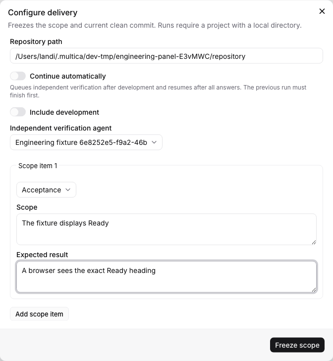

# Automatic engineering continuation

The contract's `auto_continue` policy authorizes two transitions:

- A completed development chain hands its actual clean commit and unchanged
  scope to the independent verifier, then the coordinator queues that verifier.
- A published question batch receives every active human answer, then the
  coordinator queues the same frozen role to resume the same unfinished phase.

All previous native issue runs, including deferred tasks, must be terminal before either transition queues
another run. Initial execution is still started explicitly. Editing an unpublished
question, ordinary phase progress, successful process exit, and a failed
verification conclusion do not create automatic continuation work.

## Authorization and dispatch

The shared issue configuration dialog exposes **Continue automatically**, enabled
for a new configuration. Its description states which runs it authorizes. The
setting is frozen with that contract revision. CLI configurations opt in with
`"auto_continue": true`; omitted fields and existing records remain manual.

The Go host registers `engineering_continuation_dispatch` with the existing
database-backed scheduler, approximately every 30 seconds. It asks the private
Node worker for eligible checkpoints from the latest stored contract revisions.
The worker derives each task UUID deterministically from the persisted draft ID
and sequence. It accepts coordinator credentials only over the existing private
process boundary; task/human HTTP routes cannot list cross-workspace candidates.

Before dispatch, Go checks current issue lifecycle, absence of active issue runs,
the configuring human's current membership/project visibility and permission to
invoke the selected agent, the local runtime's daemon-specific project resource,
and the current frozen role/revision/sequence/repository. It reuses native task
admission, attribution, project access, realtime events, and runtime wakeup. Issue
assignment and status do not change. The task's human principal comes from the
stored configuration; another person's answer does not grant their privileges to
the next agent.

The native task row is the dispatch receipt. A later scan finds that same UUID
and does not enqueue another task, including when the task is failed or cancelled.
A restart between queue insertion and any subsequent scan therefore observes the
existing task. No second SQLite dispatch acknowledgement is needed. Native task
retry or an explicit human continuation can recover execution failures; the
coordinator does not repeatedly recreate a failed checkpoint task. This guarantee
depends on retaining that native task row and does not cover arbitrary external
side effects or establish a PostgreSQL/SQLite/filesystem transaction.

## Evidence and remaining work

Kernel tests cover unpublished/partially answered batches, stable candidates after
storage reopen, abandonment, host-only listing, and Dev-to-verifier selection.
Backend tests exercise real native queue rows: an active prior task blocks
dispatch, including when deferred; a terminal checkpoint task is not recreated;
archived/private agents, former members, triage, and closed issues cannot continue. Existing shared admission tests also run.

The in-place case in `e2e/engineering-delivery.spec.ts` uses the running native
scheduler, CLI, Go API, worker/SQLite, temporary Git repository, real command
check, and independent Chromium observation. It observes the automatically
queued verifier after development handoff, claims that owned fixture task,
publishes a question, supplies a human answer, observes automatic continuation,
and proves the same draft/phase/answer survives. Worktree and explicit manual
continuation retain separate coverage. The fixture claims simulate runtime
metadata and never execute an installed provider or call a model.

Automatic failure classification/rework, requirement planning and final review,
remaining command chains, other provider receipts, remote repository mapping,
and real delivered-business acceptance remain pending. A task process completing
is still insufficient for the synchronous issue completion gate.
