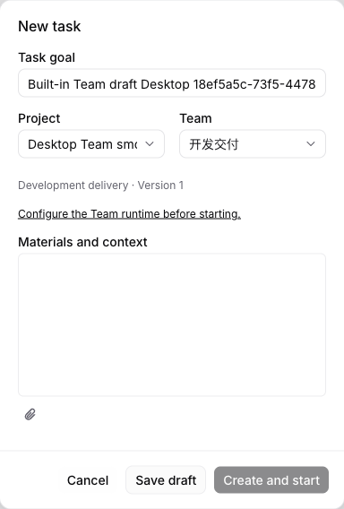

# Local packaged Desktop acceptance

The macOS arm64 packaged `.app` has passed the local single-user Team entry
scenario against the managed API. This is a locally built, ad-hoc signed app,
not a notarized installer or acceptance of model execution, every workflow,
updating, external protocol registration, other operating systems or Mobile.

The controlled scenarios below used `0.8.2-234-gcec625b1c`. The newer local fork
candidate `0.8.2-238-gc88b74ba5` has the separate bundle identity, no advertised
upstream protocol and a valid ad-hoc signature, but its standalone launch exits
before showing a window. That candidate's startup is not accepted. The managed
local Web entry is available while this desktop startup issue is investigated.

## Isolated local profile

Initialize a **new** absolute directory before launching the packaged executable:

```sh
node apps/desktop/scripts/local-profile.mjs \
  --directory /absolute/new/private/desktop-profile \
  --api-url http://127.0.0.1:18729 \
  --app-url http://127.0.0.1:13649

MULTICA_DESKTOP_PROFILE_DIR=/absolute/new/private/desktop-profile \
  "apps/desktop/dist/mac-arm64/Multica Loop.app/Contents/MacOS/Multica Loop"
```

Use the current managed environment's ports. The initializer only accepts
loopback HTTP(S) origins and refuses to replace an existing directory. It creates
private configuration files, disables daemon auto-start and automatic updates,
and places Electron preferences/session data under `electron/`. Missing runtime
configuration in an explicitly isolated profile is an error; it never silently
connects that profile to the cloud default.

The fork's local build uses its own macOS bundle identity and **Multica Loop**
product name so it can coexist with an installed upstream Multica app. Build it
from the Desktop workspace with the local builder configuration:

```sh
CSC_IDENTITY_AUTO_DISCOVERY=false pnpm -C apps/desktop package -- \
  --mac --arm64 --dir --publish never --config electron-builder.local.cjs
codesign --force --deep --sign - "apps/desktop/dist/mac-arm64/Multica Loop.app"
```

This configuration declares no upstream `multica://` protocol or publishing
channel. Continue using the explicit isolated profile when launching it.

Keep included source and build output unchanged while packaging. ASAR records
file sizes before streaming payloads; a concurrent edit can shift later file
offsets even though electron-builder exits successfully. The local build excludes
development configs/scripts and runs an after-pack gate that parses the actual
entry/version and checks the SHA-256 of every packed file against the archive
manifest. A mismatch fails the package before it can be treated as launchable.
Unpacked native executables can change during signing and are checked separately.

The native Multica CLI profile remains under
`~/.multica/profiles/desktop-<api-host>-<profile-directory-hash>/`. It has a
separate name and private local authentication file. It is not a model-provider
account. The terminal CLI's default profile and normal Desktop profile are not
reused. Keep this configuration private: the native profile can contain a local
Multica access token. Do not change `HOME` to simulate isolation.

In this mode the app uses the launcher's explicit `PATH`, skips login-shell
initialization and does not register itself as the system's `multica://`
handler. Supply the intended executable path explicitly if later enabling an
authorized runtime. Login, focus and stopped-daemon usage reporting no longer
invoke `daemon probe-runtimes` or discover installed provider tools/accounts.
A running daemon's already-reported agents can still supply usage metadata.
Starting a daemon remains an explicit operation and is outside this acceptance.

## Accepted scenario

`e2e/engineering-desktop.spec.ts` launches the packaged executable, not the web
development server. It requires an explicit executable and a new profile path,
checks that its uniquely named native profile and health port are unused, and
places fake provider executables first on the launch path. It never looks up a
real provider executable. The scenario:

1. Enters the existing local workspace without email or OAuth and confirms the
   isolated Electron data directory.
2. Navigates **Team → Teams**, showing the five actual predefined Teams.
3. Opens **Development delivery → Team settings**, confirms the fixed workflow
   and inherited role/context settings, then cancels without changing the Team.
4. Creates an owned fixture project and opens **New Issue**. The task asks for
   its goal, project, Team and materials; its two selectors are Project and Team.
   With no Team runtime bound, **Create and start** is disabled while **Save
   draft** remains available.
5. Saves a Backlog draft assigned to the Develop Team, closes and relaunches the
   same packaged app, and finds the retained task/session again.
6. Confirms the daemon stayed stopped, no provider sentinel was invoked, no
   daemon PID/port file was created, the native config is private, and all five
   Team definitions remain unchanged. `TestApiClient` removes only the owned
   draft/project fixtures. The private Desktop profile is retained for inspection.

```sh
MULTICA_ENGINEERING_DESKTOP_EXECUTABLE=/absolute/path/Multica.app/Contents/MacOS/Multica \
MULTICA_ENGINEERING_DESKTOP_PROFILE_NEW=/absolute/new/private/acceptance-profile \
make env-exec ARGS="-- pnpm exec playwright test engineering-desktop.spec.ts"
```

The managed environment must have local authentication enabled and provide
`NEXT_PUBLIC_API_URL` and `PLAYWRIGHT_BASE_URL`. Without the explicit Desktop
arguments the test skips; a skipped test is not acceptance. The test's English
locale is saved only in its isolated renderer; it does not change the shared
local user's language.




Desktop unit coverage also checks isolated configuration/defaults and missing
configuration, and proves both main-process IPC and renderer login/focus/stopped
events cannot trigger a cold provider probe. The complete Desktop suite passed
931 tests; node/web typechecks passed and lint had no errors (one existing
`tab-content.tsx` hook warning). Root script checks passed 152 tests with two
unrelated gated skips.

The actual four historical tasks remain staged under the source freeze. This
scenario neither activates them nor binds their six Develop roles. Real model
quality, full Desktop workflow/recovery lifecycles and final cutover remain
separate pending acceptance.

## Historical material and native downloads

`e2e/engineering-desktop-history.spec.ts` exercises the current host-pinned
archives through the same packaged app, using the isolated Desktop fixture. It
requires both primary and supplemental archive hashes in addition to the
executable, local authentication and a new profile directory. It never changes
the saved preparation or activates a historical task.

The local acceptance used packaged version `0.8.2-234-gcec625b1c`, the primary
archive `6d2fef8e221d3dfc1b46c61201c41b265febc2715e73184b98bce4cdb0420d62`
and supplemental archive
`9092980eb3a829cac74764db1e831049556d7e8619f8dd53b7823e08d0441235`:

- **Work → LoopWork history** displayed the 38-record primary catalog. An
  original-ID search opened one of the four staged tasks and an original
  document. Its source text matched the native API exactly, and the same
  document remained selected after a renderer reload.
- **View material** retained the exact frozen packet, saved preparation and
  staged native-task link. Opening that link reached its corresponding native
  task with the migration-pending notice. The Desktop Back button returned to
  its original historical task. The preparation offered no start/run/Done/save
  action and remained unchanged after the walk-through.
- **Download JSON** completed through Electron's native download session. The
  downloaded package matched the pinned API packet, including its source,
  sections and original ownership.
- **Supplementary history** showed the catalog of twelve available historical
  databases and 225 files. One database-scoped task marked as additional to the
  primary archive opened with its original description and survived a renderer
  reload; it supplied no migration-preparation surface.
- An original reference-inventory file downloaded through the same native
  session. Its byte count and independently computed SHA-256 matched the
  catalog. Its retained `execution_authorized` field stayed false. The private
  profile retains both downloaded files and `history-acceptance.json`.

The harness supplies the two download destinations inside its own private
profile through Electron's `will-download` hook. This verifies native download
completion and original bytes; it does not accept manual interaction with the
operating system's Save dialog. Original task/document/file contents and failure
screenshots stay in private local profiles or ignored test output, outside the
repository's committed screenshots.

Run the two Desktop scenarios together with a **new** profile prefix:

```sh
MULTICA_ENGINEERING_DESKTOP_EXECUTABLE=/absolute/path/Multica.app/Contents/MacOS/Multica \
MULTICA_ENGINEERING_DESKTOP_PROFILE_NEW=/absolute/new/private/acceptance-profile \
make env-exec ARGS="-- pnpm exec playwright test engineering-desktop.spec.ts engineering-desktop-history.spec.ts"
```

The Team scenario uses the given directory; the history scenario appends
`-history`, so their sessions/native profiles remain separate. The shared
fixture rejects existing profiles and occupied native health ports, installs
only test-owned provider sentinels, and checks stopped-daemon state. No real
provider is discovered or launched. This is bounded desktop access to retained
history, not acceptance of every record, external reference, original model
judgment or final native ownership transfer.
