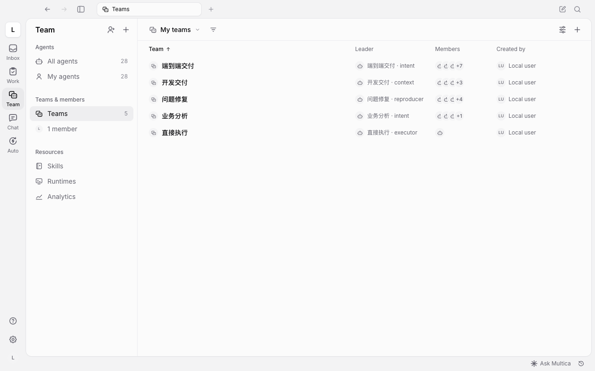
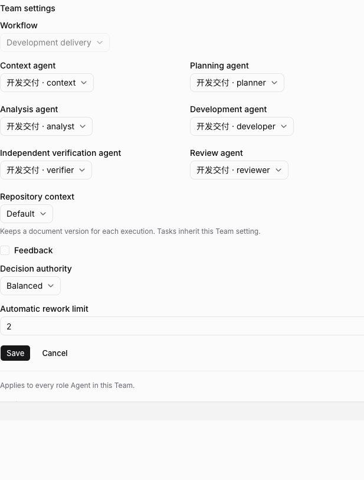

# Local packaged Desktop acceptance

The macOS arm64 packaged `.app` has passed the local single-user Team entry
scenario against the managed API. This is a locally built, ad-hoc signed app,
not a notarized installer or acceptance of model execution, every workflow,
updating, external protocol registration, other operating systems or Mobile.

## Isolated local profile

Initialize a **new** absolute directory before launching the packaged executable:

```sh
node apps/desktop/scripts/local-profile.mjs \
  --directory /absolute/new/private/desktop-profile \
  --api-url http://127.0.0.1:18729 \
  --app-url http://127.0.0.1:13649

MULTICA_DESKTOP_PROFILE_DIR=/absolute/new/private/desktop-profile \
  apps/desktop/dist/mac-arm64/Multica.app/Contents/MacOS/Multica
```

Use the current managed environment's ports. The initializer only accepts
loopback HTTP(S) origins and refuses to replace an existing directory. It creates
private configuration files, disables daemon auto-start and automatic updates,
and places Electron preferences/session data under `electron/`. Missing runtime
configuration in an explicitly isolated profile is an error; it never silently
connects that profile to the cloud default.

The native Multica CLI profile remains under
`~/.multica/profiles/desktop-<api-host>-<profile-directory-hash>/`. It has a
separate name and private local authentication file. It is not a model-provider
account. The terminal CLI's default profile and normal Desktop profile are not
reused. Keep this configuration private: the native profile can contain a local
Multica access token. Do not change `HOME` to simulate isolation.

In this mode the app uses the launcher's explicit `PATH`, skips login-shell
initialization and does not register itself as the system's `multica://`
handler. Supply the intended executable path explicitly if later enabling an
authorized runtime. Login, focus and stopped-daemon usage reporting no longer
invoke `daemon probe-runtimes` or discover installed provider tools/accounts.
A running daemon's already-reported agents can still supply usage metadata.
Starting a daemon remains an explicit operation and is outside this acceptance.

## Accepted scenario

`e2e/engineering-desktop.spec.ts` launches the packaged executable, not the web
development server. It requires an explicit executable and a new profile path,
checks that its uniquely named native profile and health port are unused, and
places fake provider executables first on the launch path. It never looks up a
real provider executable. The scenario:

1. Enters the existing local workspace without email or OAuth and confirms the
   isolated Electron data directory.
2. Navigates **Team → Teams**, showing the five actual predefined Teams.
3. Opens **Development delivery → Team settings**, confirms the fixed workflow
   and inherited role/context settings, then cancels without changing the Team.
4. Creates an owned fixture project and opens **New Issue**. The task asks for
   its goal, project, Team and materials; its two selectors are Project and Team.
   With no Team runtime bound, **Create and start** is disabled while **Save
   draft** remains available.
5. Saves a Backlog draft assigned to the Develop Team, closes and relaunches the
   same packaged app, and finds the retained task/session again.
6. Confirms the daemon stayed stopped, no provider sentinel was invoked, no
   daemon PID/port file was created, the native config is private, and all five
   Team definitions remain unchanged. `TestApiClient` removes only the owned
   draft/project fixtures. The private Desktop profile is retained for inspection.

```sh
MULTICA_ENGINEERING_DESKTOP_EXECUTABLE=/absolute/path/Multica.app/Contents/MacOS/Multica \
MULTICA_ENGINEERING_DESKTOP_PROFILE_NEW=/absolute/new/private/acceptance-profile \
make env-exec ARGS="-- pnpm exec playwright test engineering-desktop.spec.ts"
```

The managed environment must have local authentication enabled and provide
`NEXT_PUBLIC_API_URL` and `PLAYWRIGHT_BASE_URL`. Without the explicit Desktop
arguments the test skips; a skipped test is not acceptance. The test's English
locale is saved only in its isolated renderer; it does not change the shared
local user's language.






Desktop unit coverage also checks isolated configuration/defaults and missing
configuration, and proves both main-process IPC and renderer login/focus/stopped
events cannot trigger a cold provider probe. The complete Desktop suite passed
931 tests; node/web typechecks passed and lint had no errors (one existing
`tab-content.tsx` hook warning). Root script checks passed 152 tests with two
unrelated gated skips.

The actual four historical tasks remain staged under the source freeze. This
scenario neither activates them nor binds their six Develop roles. Real model
quality, full Desktop workflow/recovery lifecycles and final cutover remain
separate pending acceptance.
