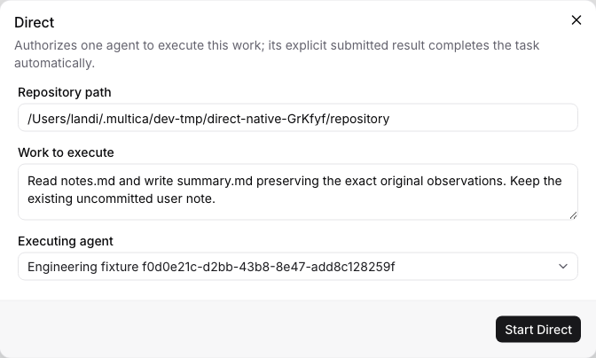
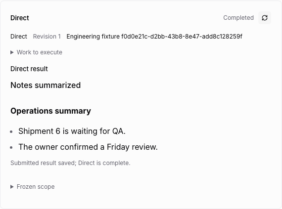
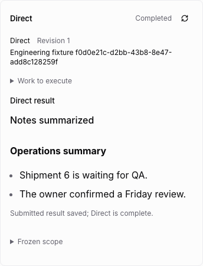

# Direct

Direct runs one frozen instruction through one native agent and saves an explicit
result. It has no analysis/planning YAML, independent Test, or report-reading
stage. The source acceptance is `direct-command.ts` and
`direct-pipeline.test.ts` in the pinned LoopWork baseline.

## Configure and execute

Choose Direct on an idle, open project issue. Select the executing native agent,
registered local work directory and original work instruction. Go derives the
actual project and resource mode; a client cannot supply a different project or
creator. Configuration cannot replace another workflow on the issue.

In-place execution supports both Git repositories and ordinary local directories,
including existing user changes. A Git commit is recorded when available; an empty
commit identifies a plain directory rather than an invented code version. Worktree
mode requires a registered Git root and a real commit. The daemon must bind the
actual directory and runtime overlays before the provider starts.

The first task is queued automatically. The agent must use the dedicated protocol:

```sh
multica engineering direct-run
# Perform the frozen work and save UTF-8 files under the task-private TMPDIR.
multica engineering direct-submit --summary-file "$TMPDIR/summary.txt" --result-file "$TMPDIR/result.md"
```

`direct-submit` requires the current bound attempt's RUN receipt. The summary is
trimmed, nonempty and at most 4,000 JavaScript UTF-16 code units. The optional
Markdown result is trimmed and at most 100,000 code units; omitted or empty content
falls back to the summary. The management CLI accepts regular UTF-8 files inside
the task-private TMPDIR, preserving Markdown and newlines. Symlink escapes and
external files are refused.

An ordinary final reply or process exit cannot submit a result. The first accepted
result, its attempt and fingerprint are saved in one SQLite compare-and-swap write.
Repeating SUBMIT on that attempt returns the original receipt even when the later
payload differs, matching the source's first-result-wins behavior.

## Interruption and completion

After an interrupted native task, Continue run starts a new native attempt. Binding
it supersedes the prior attempt, and it needs its own RUN receipt. Old task
credentials cannot publish a result. Automatic continuation does not replay an
already bound attempt or terminal checkpoint task, because Direct may have made
external changes that are not safe to replay.

After SUBMIT, the coordinator waits for every native run on the issue to finish.
The synchronous Done guard rechecks the exact result fingerprint, original project,
agent and native claim generation. A result submitted while its process is still
running cannot close the issue. The coordinator then acknowledges native completion
in private state. An interrupted post-Done acknowledgement is retried without
rewriting the native issue. The shared Web/Desktop panel displays the original
work, summary and Markdown result; it polls until native acknowledgement.

Direct completion is the submitted outcome of this work. It is not independent
delivered-code verification. It cannot supply another chain's verified binding or
bypass that chain's Test gates.

## Verification boundary

Kernel tests cover explicit submission, original limits, immutable receipts after
reopening SQLite, old-attempt fencing, actual file changes, worktrees and plain
directories. Handler and CLI tests cover native project/resource derivation,
credential boundaries, claim instructions and completion/acknowledgement recovery.
The daemon suite uses only test-created fake provider executables, including a
plain-directory case.

The controlled browser scenario passed for both Git and plain directories in
2.1 minutes. It configures Direct, refuses premature Done and
SUBMIT, fails one task, continues through a new RUN, writes a real summary file,
retains the first result, waits for idle native completion and displays Markdown at
1280 and 390 pixels. It is run for both Git and plain directories. This does not
establish real-provider or installed Desktop acceptance.

The [terminal intervention handoff](intervention.md) now freezes Direct's current
RUN and original investigation evidence. Its independent Admin repair path remains
incomplete; normal RUN/SUBMIT completion does not establish that recovery path.

Screenshots were inspected after the browser run:






