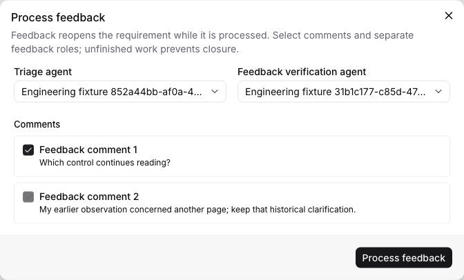
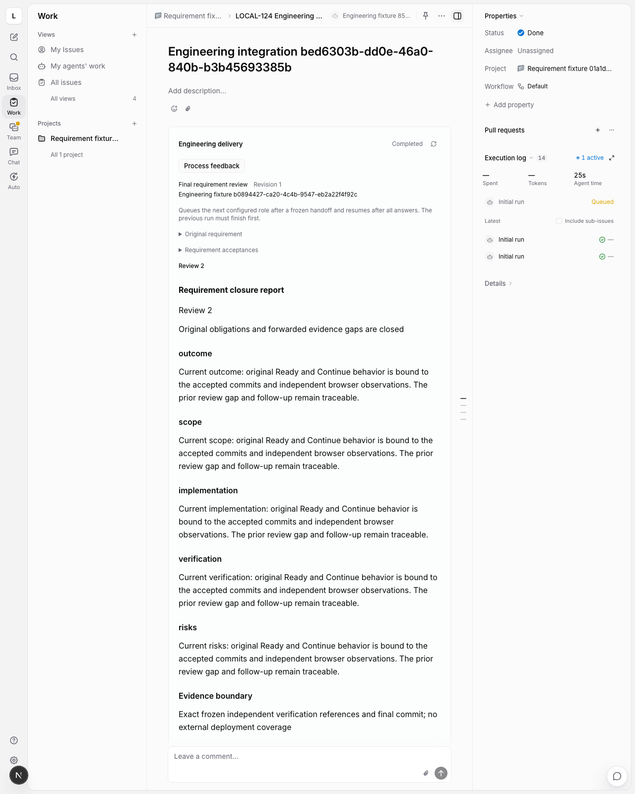
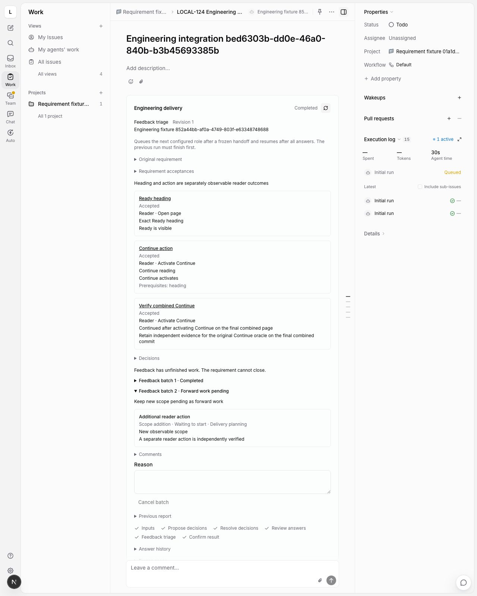
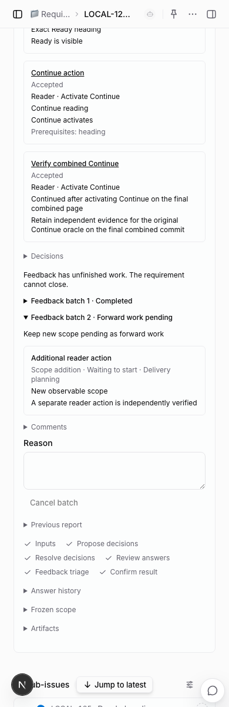
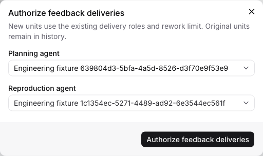
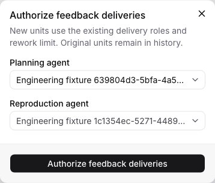
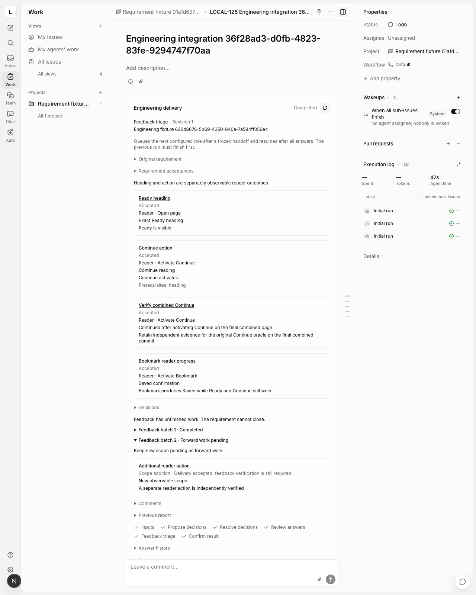
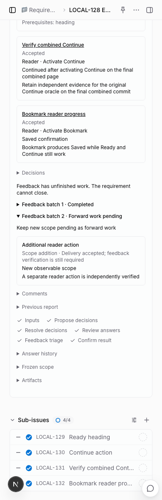

# Feedback protocol and durable batches

The native requirement page and management CLI capture comments and queue a
frozen Feedback Triage role. Immediate dispositions can retain the original
report; forward work remains pending and blocks requirement completion. The
worker embeds nine definitions, including Feedback Verify. Frozen feedback
reproduction/planning can append managed deliveries; report correction and
per-comment verification are not connected yet.
This is a partial feedback migration.

## Native capture and human controls

`Process feedback` is available against a valid final requirement report,
including a requirement already in Done. The human selects native comments and
two distinct invocable roles, both separate from the three delivery roles. Go
loads actual comments from the same workspace and parent; clients submit IDs,
not comment bodies or authors. Capture freezes full text, source revision,
author, version hash, original context/report, delivery-unit snapshots, actual
definition sources, repository mapping and execution mode. Attachment IDs,
filenames, content types and sizes are references only: file bytes and signed
download URLs are not captured or interpreted.

Admission reopens Done to Todo, preserving assignment and project. Triage uses
the native task queue, attempt ownership, readonly repository binding and
authenticated human-answer flow. The shared Web/Desktop panel shows batch
dispositions and source versions. It does not mark native discussion threads
resolved or rewrite requirement acceptances and historical artifacts.

The CLI exposes `engineering start-feedback` and `engineering cancel-feedback`;
use each command's help for the JSON payload. Cancellation records the reason
and preserves unresolved comments, which continue to block Done. Once idle,
those comments can be captured in another batch. Captures retry under their
original request ID; changed source versions require new input.

```sh
multica engineering start-feedback <requirement-id> --payload-file feedback.json
multica engineering cancel-feedback <requirement-id> --payload-file cancellation.json
```

`feedback.json` supplies `request_id` (a new UUID), `expected_revision`,
`expected_sequence` (the report checkpoint), `expected_batch_number` (the latest
batch number, initially zero), `agent_id`, `verifier_id` and `comment_ids`.
`cancellation.json` supplies `batch_id`, `expected_version` and `reason`.
The issue overview exposes those checkpoints. Native identities, source
snapshots and repository resources are derived by the host.

When every comment receives only `reply`, `historical_correction` or
`learning_only`, the previous report remains valid. A previously Done parent
can return to Done only after the ordinary completion gate rechecks current
native children, accepted evidence and the exact human reading acknowledgement.
An unacknowledged report still requires reading. SQLite settlement and native
PostgreSQL lifecycle writes are separate: a durable restoration marker lets the
coordinator retry the native write and acknowledgement. This is not one
cross-database transaction.

Forward groups initially retain `waiting_for_repro`, `waiting_for_plan` or
`waiting_for_report`. Their completed triage cannot close the parent. The panel
keeps the prior report under `Previous report` and hides its closing action
while unresolved comments remain, including after cancellation.

## Forward reproduction, planning and delivery

After triage, **Authorize feedback deliveries** freezes an invocable planner and,
for defect groups, a separate reproducer. Both must be separate from the frozen
delivery roles and feedback verifier, and use the same registered repository and
execution mode. Existing analysis/development/verification roles and per-unit
rework budget remain the delivery policy. The CLI exposes
`engineering start-feedback-deliveries <requirement-id> --payload-file work.json`;
the payload contains `batch_id`, `expected_version`, `planner_agent_id` and, for
defects, `reproduction_agent_id`.

Each group's planning freezes only its comments, explicit acceptances, affected
unit versions and original report context. Defects first bind readonly
reproduction to original accepted oracles from their affected units (all frozen
units when no subset is declared). Missing facts use authenticated questions and
renewed observation. Only reproduced can hand off its retained observation report
to planning. New-scope, behavior and technical groups enter planning directly.

All delivery groups plan against the same frozen reviewed commit before any new
unit becomes executable. Each forward runtime attempt binds one exact group
draft; it cannot start or rebind the next group's checkpoint. The last completed
plan atomically appends every group's
stable unit intent, permanent feedback acceptances and origin references in
SQLite. Local keys are namespaced by group; dependencies remain within their
frozen plan. Original units and acceptances are retained, and each new unit records
its batch, group, planning draft and corrected-unit IDs. Saved terminal plans can
settle after reopening storage without appending twice.

Native task worktrees are disposable. Forward bindings retain their exact named
branch as well as draft identity; a completed plan can settle after its worktree
is reclaimed only while that retained ref still names the frozen commit. Branch
drift is rejected. This does not establish native worktree acceptance for the
entire requirement/review path or substitute for a fresh active-run binding.

The native coordinator publishes the intents with the existing stable-ID child
service. New units then use serial analysis → development → independent Test
from acknowledged predecessor commits, including guarded native Done and host
acceptance. Group delivery acceptance still leaves comments unresolved and the
parent open in `waiting_for_verify`; it does not count as Feedback Verify or a
new closure report. A frozen append intent requires explicit reconciliation
before cancellation; the batch cancel action cannot discard native delivery scope.

Report-correction groups remain pending. Revising an original oracle when a
behavior change contradicts it also requires explicit contract reconciliation;
appending a new acceptance does not retire or silently weaken the original one.

## Protocol gates

The definitions import the source `feedback-agent.triage.yaml` and
`feedback-agent.verify.yaml`; comments are translated, while artifacts,
instructions and phase order remain unchanged.

Triage freezes a batch ID, ordered comment IDs and delivery-unit count. Its
contract also carries full comment versions/content/source references, parent
context and unit snapshots. Every comment must appear in exactly one stable
group. Unknown, omitted or repeated comments, invalid unit indexes, and missing
work-type-specific fields prevent finalization.

| Work type | Required routing facts | Durable initial state |
| --- | --- | --- |
| `reply` | Reason and explicit response | Completed without code work |
| `historical_correction` | Reason and explicit correction response | Completed without rewriting historical artifacts |
| `learning_only` | Reason | Completed as learning only |
| `bug` | Title, reason and verifiable acceptance | Waiting for reproduction |
| `behavior_change` | Title, reason and verifiable acceptance | Waiting for planning |
| `scope_addition` | Title, reason and verifiable acceptance | Waiting for planning |
| `technical_change` | Title, reason and verifiable acceptance | Waiting for planning |
| `report_correction` | Title, reason and verifiable acceptance | Waiting for a revised report |

The immediate dispositions follow the source behavior. Their classification is
an agent judgment, not deterministic proof that a comment needs no code change.
Clarification uses the existing decision policy and authenticated answer
snapshots; requesting a human choice prevents later substitution of another
option or agent authority. The answer review and completed phase order are
required before compiling triage.

Verify freezes exactly one comment, its group and the authoritative forward
work version. It requires a summary, independent evidence and a reason for
`resolved` or `reopened`. It cannot ask questions or runtime inputs, verify a
different comment or silently accept another code binding. Evidence text does
not itself prove an observation happened or is semantically sufficient.

## Store responsibilities and recovery

`FeedbackStore` is an internal host dependency, not an authenticated API. Its
caller owns native actor lookup, permissions, issue lifecycle, clean repository
binding and source-version validation. The store never receives bearer tokens.
The main package entry stays platform independent; import storage through the
explicit `@multica/command-chain/feedback-store` subpath.

Capture pins both actual definition sources and full feedback snapshots. A
stable request ID retries the same capture; changing its input rejects reuse.
One active batch per issue is permitted. A different workspace is independent.
Batch numbers and SQLite versions reject competing captures and stale writes.
The store reads completed drafts from its trusted `SqliteDraftStore` and
recompiles them; callers cannot submit a claimed triage or verification result.

Triage settlement creates stable group IDs and preserves each forward routing
state. An immediate disposition resolves only its own comments. No pending
delivery/report group becomes complete because an agent process exited or a
triage draft completed.

Before freezing or settling Verify, an injected authoritative work resolver must
obtain actual completed delivery or report evidence. Without that resolver the
store refuses verification. Report correction requires report evidence; other
forward groups require delivery evidence. All comments in one group bind the
same work snapshot. Changed work is rejected before results are applied. This
interface is not a production resolver and does not establish native ownership,
independence or readiness by itself.

Each comment has its own frozen verification draft and result. A reopened
comment does not resolve an unverified sibling; all comments in a group must
reach their own results before that group becomes terminal. Historical batch
and result records remain immutable. A reopened comment may then enter a new
batch with a new ID and draft, retaining its source version and the previous
failure's reason, observations and work binding as frozen context. A resolved
source version cannot be captured again; an edited source version is new input.

Result receipt, comment state, group state and batch version settle in one
SQLite transaction. Storage can reopen and retry an identical completed draft
without duplicating groups or results. This is not a cross-database or generic
exactly-once claim. Native publication and SQLite acknowledgements are separate
retryable operations, not a cross-database commit.

An explicit host-authorized cancellation records actor, reason and time, leaves
completed facts intact, and returns unfinished comments to pending input.
Cancellation cannot count as feedback resolution. A work lookup that returns
after cancellation cannot revive the old batch.

## Evidence and remaining integration

Protocol and real SQLite tests cover all eight routing types, exact comment
coverage, scope/version rejection, human option authority, evidence requirements,
storage reopen, competing captures, per-comment outcomes, failed-evidence
retention, work-version drift, transactional write failure and cancellation
during an asynchronous work lookup. Work resolver results are controlled test
fixtures; no provider/model is invoked by these tests. Host tests cover in-place
and worktree bindings, frozen role separation, saved triage recovery, guarded
restoration and cancellation that leaves completion blocked. Native handler
tests cover actual comment lookup, spoofed/foreign input rejection, queue claim
and preserving parent fields. Shared UI/API tests cover native comment/role
selection, stable retry input, malformed responses and pending feedback.

Forward host tests cover reproduced-only defect handoff, group-scoped sources,
multiple groups sharing a planner/local key, all-plan publication barriers,
terminal-plan recovery, stable origin/acceptance IDs, immutable work policy,
attempt-to-draft fencing, reclaimed worktrees and retained-ref drift. They run
actual SQLite/Git and controlled delivery protocol commands in both directory
modes; they do not prove native provider execution or semantic evidence truth.

The controlled native requirement browser scenario runs the actual UI,
management CLI, Go scheduler and private worker. After actual Git changes,
independent Chromium observations, review-gap delivery and human report reading,
it captures native comments from Done. Reply/historical dispositions restore
guarded Done; a second scope-addition batch remains open and rejects direct Done.
That batch then authorizes a planner, freezes scoped planning, publishes a fourth
native child and serially delivers an actual Bookmark action. Chromium observes
Saved while Ready and Continue still work. After guarded native child acceptance,
the parent still rejects Done and displays pending Feedback Verify. The ledger
is checked on desktop and a 390px viewport. Classifications
and protocol commands are fixture-supplied, not model-generated. The fixture
removes only its owned native records and SQLite batches after acceptance.

A separate browser layout regression uses a fixed pending-defect overview and a
mocked authorization response. Real role selectors and pointer submission check
long names, distinct roles, popup bounds and reachable controls at desktop/390px
widths. This UI test does not establish native work authorization by itself.

An authoritative resolver must bind the actual accepted forward deliveries or
corrected report before permitting per-comment verification. Parent completion
must account for pending/reopened
comments, current report generation and authenticated reading. These forward
gates, real-provider acceptance and packaged Desktop acceptance remain required
before post-delivery feedback can be described as fully migrated.
















