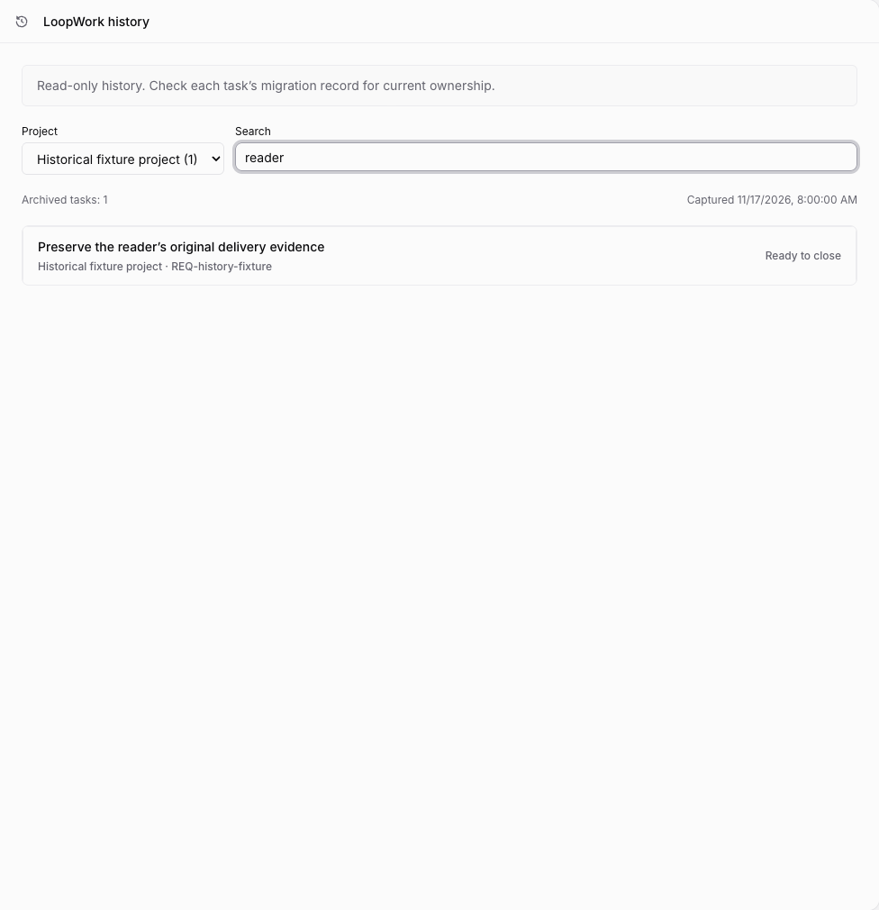
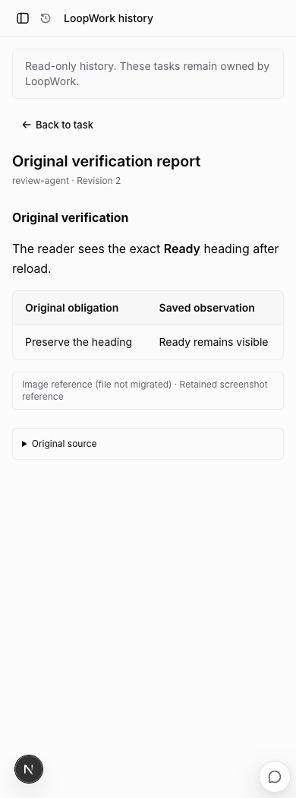
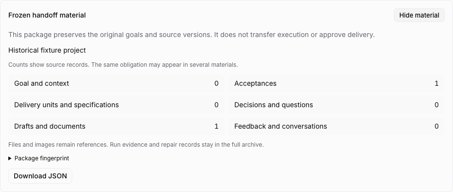
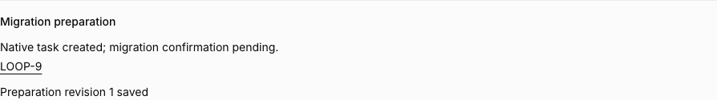
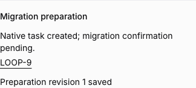
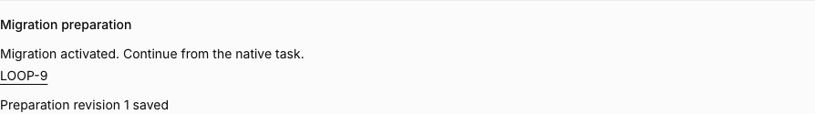
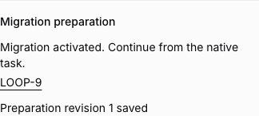
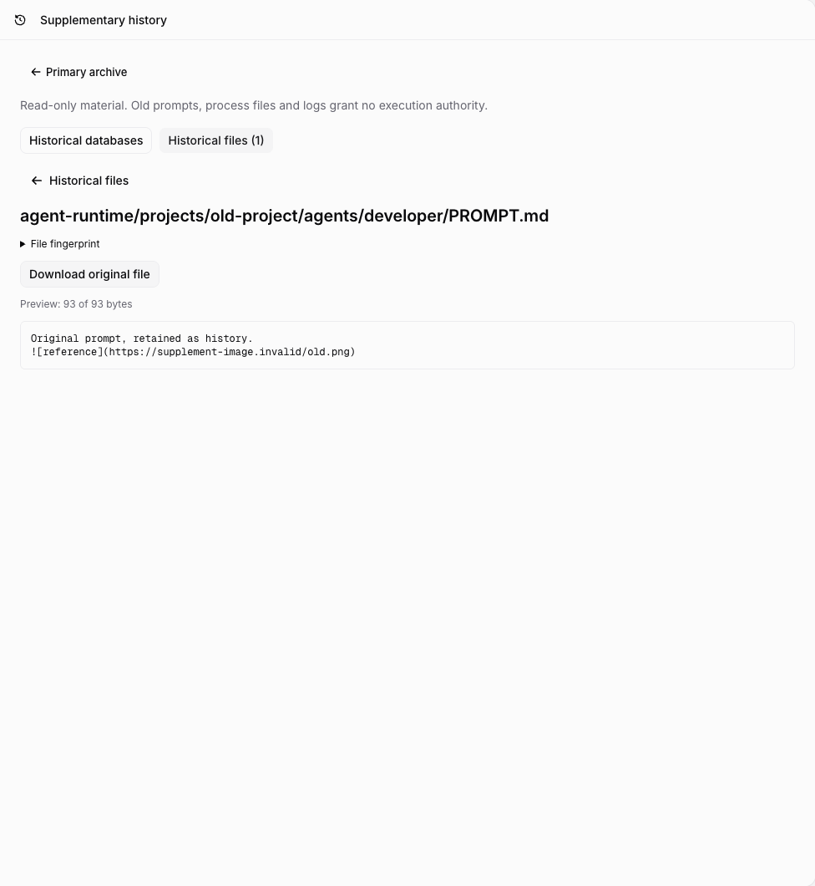
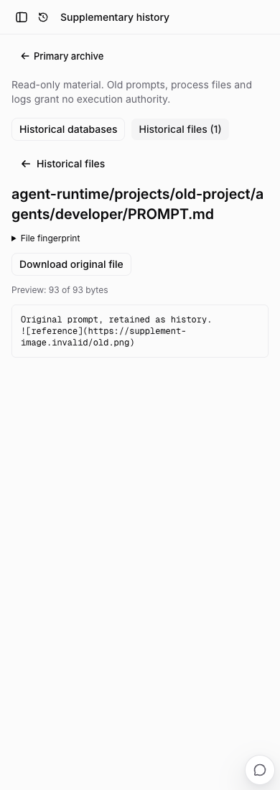

# LoopWork historical records

The migration tool captures the current shared LoopWork business database and
independent management database as local, queryable history. It does not create
Multica issues, bind a Team, resume a native claim or grant completion authority.
Unfinished source tasks keep LoopWork as their owner until an explicit cutover.

## Capture and inspect

Run from the Multica fork with Node's SQLite support:

```sh
node scripts/migration/loopwork-history.mjs capture \
  --source-root /absolute/LoopWork \
  --data-root /absolute/LoopWork/data \
  --output /absolute/migration/loopwork-capture
node scripts/migration/loopwork-history.mjs verify \
  --archive /absolute/migration/loopwork-capture
node scripts/migration/loopwork-history.mjs record \
  --archive /absolute/migration/loopwork-capture \
  --table tasks --id original-task-id
```

Paths must be absolute. Select the actual data root explicitly; the tool does
not load `.env` files, discover providers or start either application. This
version supports the source's shared `loop-ui.db`, application `loopwork.db`
and optional independent `admin-management.db` layout. A deployment using a
custom global-database filename needs explicit support before capture. The
tracked source checkout must be clean; its exact Git commit is recorded.

The output must be new and outside both source roots, including paths through
symlinks. Failed captures remove only their private staging directory. Existing
archives are never overwritten. The archive directory is private (`0700`), with
`0600` files. Keep it with the local migration artifacts, outside Git.

Only byte reads touch the source databases. The tool fingerprints the database
and WAL, copies them, compares copied/source fingerprints and rechecks the whole
cohort before publication. A rollback journal, changing source, missing required
schema or task without its project owner refuses capture. SQLite reconstructs
shared memory, validates and checkpoints only the private copies. The final
archive contains self-contained business/management databases and a hashed
manifest; it does not depend on the source WAL or recreate source directories.

## What is preserved

The manifest records every archived table's row count, columns and original
primary keys, projects, task states, source-run facts, unfinished task IDs and
legacy-import lineage. Original contracts, documents, conclusions, drafts,
questions, decisions, observations, receipts, comments, reading acknowledgements,
runtime history and repair provenance remain in their original database rows.
Database fingerprints protect their exact captured bytes. `verify` checks both
the files and the record inventory before lookup.

`record` accepts exact original IDs, including non-UUID and UTF-8 IDs. Supported
lookup tables are `tasks`, `documents`, `stories`, `agent_work_drafts`,
`command_chain_drafts`, `business_analysis_drafts`, `execution_attempts`,
`repair_cases` and `repair_observations`. Repair records are read from the
separate historical management database. Unknown tables are refused, IDs are SQL
parameters, and an absent record returns `null`. SQLite integers use lossless
`{"sqlite_integer":"..."}` JSON values; blobs use `{"sqlite_blob":"..."}`.

Application configuration gets schema/count inventory and the configured
workspace root only. Its database payload is excluded from the archive.
Application runtime credentials need a separate explicit configuration migration.
The [configuration retention tool](configuration-migration.md) now separately
preserves the four known Agent Prompt/YAML tables and derives five-Team
correspondence. It excludes runtime/account tables and installs no configuration.
Historical business/management payloads remain private historical data; old
credential hashes and private prompt/tool content may occur there. Record lookup
omits top-level credential/token columns. No old token, lease, runtime selection,
controller or management intent is installed into Multica.

Already merged legacy project databases are identified through the current
business database's own import records, preserving those original paths and IDs.
They are not imported again. Other `.db`/`.sqlite` files at the data root and one
project-directory level are listed as unclassified. This is a bounded inventory,
not a claim that every historical deployment or backup has been found.

## Actual local capture

A read-only capture of the pinned LoopWork baseline
`17982f2b93100b42d65ed650869c9cc97ff92b5a` produced:

- Business: 95 tables, 123,139 rows, 4 projects and 38 tasks; 8 tasks remain
  unfinished. The source's `ready_to_close` and waiting states are preserved.
- Management: 46 tables, including 2 repair Cases and 4,377 original observations.
- Original content includes 197 documents, 30 command-chain drafts, 12,113
  execution receipts, 280 execution attempts and 107 runs.
- Four already merged legacy project sources are identified; twelve other
  database files were initially unclassified. The [supplement](#supplementary-databases-and-files)
  below now records their observed schema and disposition. This original capture
  created no native task.

The archive manifest is content identity
`6d2fef8e221d3dfc1b46c61201c41b265febc2715e73184b98bce4cdb0420d62`.
The validated local artifact is kept under the persistent
`~/.multica/migrations/loopwork/20261117-01` directory, outside managed environment
expiry and deletion. Its comparison report is stored alongside that directory.
The capture command reports its selected output path; archives can be relocated
without changing content identity. `verify` and exact-ID
lookups were exercised on this actual capture. A separate full-record comparison
checked all 141 business/management tables and 127,523 rows, ordered by original
primary keys, using framed lossless row hashes. Source database/WAL fingerprints
were unchanged before and after that comparison. Its report pins this exact
archive hash; no native execution ownership was transferred. These counts
describe that snapshot, not future source state or completed cutover.

## Native browsing

Local single-user deployments can opt into native history with both settings in
the managed environment's private configuration:

```dotenv
MULTICA_LOOPWORK_HISTORY_ARCHIVE=/absolute/migration/loopwork-capture
MULTICA_LOOPWORK_HISTORY_HASH=the_exact_hash_from_manifest
```

Use the actual 64-character manifest hash, an absolute persistent archive path,
local authentication and the engineering worker. Restart the API after changing
these settings. The archive remains outside managed environment expiry.

In Web and shared Desktop routing, open **Work → LoopWork history**, select a
source project or search its tasks, then open the task and its original document.
Task/document selection is in the URL, so refresh, direct links and browser Back
retain the source identity. Project/Team preparation is a separate native write
below the frozen material; issue adoption and exclusive execution handoff remain
incomplete. Installed Desktop acceptance remains outstanding.

The authenticated native routes are:

- `GET /api/engineering/history/availability`
- `GET /api/engineering/history?project_id=...&search=...&offset=...`
- `GET /api/engineering/history/tasks/{original-id}`
- `GET /api/engineering/history/tasks/{original-id}/documents/{original-id}`
- `GET /api/engineering/history/tasks/{original-id}/packet`

Only the reserved local human and local workspace can read this deployment's
archive. Other members/workspaces and task/cloud machine credentials cannot
consume it. Requests cannot select a filesystem path or archive hash. The host
pins the configured identity, the private history reader revalidates archive
files/inventory on each read, and Go checks the response identity. This worker
mode does not initialize engineering storage or accept execution commands.

Shared API clients send an explicit workspace identity, with query caches scoped
to both workspace and user. Navigation and command-palette entries follow the
same authenticated availability. Historical source state is displayed as history;
there is no run, Team reassignment, answer or Done operation. Reports preserve
the original text and revision. Markdown images remain labelled references until
external files are migrated; they are not automatically fetched. The source-text
disclosure retains original image/file references without executing them.

Controlled browser evidence covers project filtering/search, task/report links,
refresh and Back, read-only controls and 1280/390-pixel layouts using fixture
content. A separate configured-browser scenario reads the actual pinned archive.
Native permission/hash tests and a real private-worker round trip cover the
backend boundary. An authenticated read audit compared all 4 projects, 38 task
records and 197 full documents with the actual archive, including task/document
scope, original text and revision. Archive bytes were unchanged. Its local report
is `~/.multica/migrations/loopwork/20261117-01-native-read-correspondence.json`.
These checks do not establish native adoption, provider execution or
packaged-client acceptance.

The screenshots below contain controlled fixture content only:





## Frozen task material

Open an original task and choose **Frozen handoff material → View material →
Download JSON**. The shared Web/Desktop page loads the package only on request,
shows material counts and source-project deletion, and records schema gaps.
Counts are source records, not unique obligations or a completion verdict.
The equivalent offline read is:

```sh
node scripts/migration/loopwork-history.mjs packet \
  --archive /absolute/migration/loopwork-capture \
  --expected-hash the_exact_hash_from_manifest \
  --task original-task-id
```

`loopwork-task-handoff-v1` projects 31 named source material tables: original
project/task context, acceptances, Stories and versioned specifications,
dependencies and delivery context, draft artifacts and decisions, business
analysis artifacts, questions/answers, full documents, feedback and context
conversations. Every indirect lookup follows the original task's draft, batch,
group or session. Dependency IDs remain references; unrelated task material is
not expanded. Original JSON fields remain exact text. SQLite integers and blobs
use the lossless tags described above. Missing tables/fields are explicitly
unavailable, never silently reported as an empty complete contract. Columns
outside the fixed projections are listed as omitted.

Each package retains the archive identity, capture time, source task/project IDs,
source terminal/deleted facts and explicit LoopWork ownership. Its SHA-256 is
over the UTF-8 JSON body without `hash`, recursively sorting object keys
lexicographically and preserving array order. No generation timestamp is added;
repeating a read of the same archive produces the same package identity.
The downloaded, API-validated representation preserves this canonical digest.

Exporting this material does not create a native project, issue, Team binding or run.
Old approvals, answers and completed drafts remain historical facts; they do not
authorize a new native workflow or Done. Execution receipts, attempts,
process/repair ownership and reading records remain in the complete archive,
outside this material projection. External files/images remain references;
neither their bytes nor their validity have been established by exporting JSON.
Tables outside these 31 sections still require explicit cutover reconciliation.

The actual local snapshot produced 38 private packages under
`~/.multica/migrations/loopwork/20261117-01-task-packets`. Its manifest records
all 38 package hashes and an independent source-field comparison of 1,484
project/task/material rows across 31 sections per task. All projected fields
match and archive bytes remain unchanged. Four of the eight unfinished source
tasks belong to the active project; the other four belong to deleted projects.
Those deleted-project tasks remain history, without automatic reactivation.
This is frozen migration preparation material. Native project/Team proposals
can now be saved separately, while native issue correspondence, exclusive
ownership transfer and end-to-end cutover remain incomplete.

Controlled browser checks cover material expansion, 1280/390-pixel layouts,
actual JSON download, lossless versions and independent digest recomputation.
The screenshots below contain fixture material only:




## Native project and Team preparation

On **Work → LoopWork history → original task → View material**, use
**Migration preparation** to choose a native project and compatible Team, then
**Save preparation**. Creating the original project copies its name into a new
native metadata record; it does not copy repository paths into native resources
or discover/configure a runtime. Once a source project is mapped, its sibling
tasks reuse that project. A missing or unavailable target blocks preparation
instead of silently creating a replacement.

The local-owner routes are:

- `GET /api/engineering/history/tasks/{original-id}/preparation`
- `POST /api/engineering/history/tasks/{original-id}/preparation`

The write accepts only the expected preparation revision, packet hash, Team ID
and revision, plus a native project or an explicit create-project choice. It does
not accept per-task Agent/policy overrides, a caller-selected archive, a source
namespace or an execution owner. Source lookup is host-pinned and revalidates
the archive. A separate readonly worker action derives the source namespace
from the captured repository/data-root identity; moving the archive preserves
it, and a later capture of the same source can create a new preparation version
without duplicating project correspondence. Moving the source roots requires
explicit reconciliation rather than name-based matching. The existing v1 packet
and its digest remain unchanged by this lookup.

Native PostgreSQL stores one project correspondence per workspace/source/project
and append-only preparation versions per original task. A source-project lock,
project creation, correspondence and initial preparation commit together.
Concurrent siblings and unchanged acknowledgement retries reuse the project and
preparation IDs. Stale material, Team versions and preparation revisions are
rejected. Each preparation keeps the exact packet, native human and proposed
Team profile; later Team edits never rewrite that saved snapshot. Only the latest
matching proposal is labelled current. This describes proposal freshness, not
execution readiness. Deleting a native project or Team retains historical
provenance and makes the proposal unavailable/stale.

Current source-kind correspondences are `feature → develop`,
`business-analysis → business_analysis`, `end-to-end → end_to_end`, and
`bug → bug_fix`. Only compatible configured Teams are offered. Deleted source
projects, terminal tasks, incomplete material and other source kinds require
reconciliation; they do not fall back to Direct. The task selects a Team without
choosing its individual Agents.

Preparation always retains `source_owner: LoopWork` and
`execution_authorized: false`. It creates no native issue, run, Team task binding
or completion/reading record. Future activation must establish source release
and physical/resource ownership, reconcile the original material and required
external files, then freshly validate the native human, project, Team and
runtime. A historical answer or successful old execution is not new authority.

The actual pinned capture now has one native project correspondence and four
version-1 task preparations, using the Develop Team. The other four unfinished
tasks belong to deleted source projects and remain excluded. An authenticated
API/database audit compared every saved packet and Team profile, replayed the
same writes, and checked unchanged native issue/run counts and archive bytes.
Its private report is
`~/.multica/migrations/loopwork/20261117-01-native-preparation-correspondence.json`.
Isolated PostgreSQL tests cover sibling concurrency, replay, immutable versions,
stale scope, rejection rollback and missing targets; browser checks cover the
project/Team form and a real saved preparation. Provider and installed-client
acceptance remain outstanding. Screenshots contain fixture data only:


## Pre-activation freeze and rollback

The local operator tool now connects a durable native project hold to source
database write guards. It supports the saved preparations before any native
issue, chat, project resource or controller has been adopted. This is a
pre-activation protocol: none of its phases can start native execution.

Run from this checkout's managed environment:

```sh
make env-exec ARGS="-- node scripts/migration/loopwork-cutover.mjs plan"
make env-exec ARGS="-- node scripts/migration/loopwork-cutover.mjs probe"
make env-exec ARGS="-- node scripts/migration/loopwork-cutover.mjs hold --expected-scope REVIEWED_PLAN_SHA256"
make env-exec ARGS="-- node scripts/migration/loopwork-cutover.mjs status --id SAVED_CUTOVER_UUID"
make env-exec ARGS="-- node scripts/migration/loopwork-cutover.mjs freeze --id SAVED_CUTOVER_UUID"
make env-exec ARGS="-- node scripts/migration/loopwork-cutover.mjs observe --id SAVED_CUTOVER_UUID"
make env-exec ARGS="-- node scripts/migration/loopwork-cutover.mjs rollback --id SAVED_CUTOVER_UUID"
```

`plan` only reads source bytes through private copies. It requires the pinned,
clean source checkout, exact archive/database/WAL preimages, stopped business
and management intents and logical process records, and a current preparation
for every unfinished task in every non-deleted source project. Deleted-project
tasks remain historical. The plan contains hashes and counts, including the
application database's logical digests; it contains no application credentials.
All source paths come from the configured verified archive. Native access uses
the local PostgreSQL connection and the reserved local human's owner/admin
membership; this is a host operator tool, not a task or HTTP command.

`hold` requires the reviewed plan hash, freezes the preparation identities under
their source-project locks, locks native projects and commits the hold before
any source mutation. Identical acknowledgement retries return the same cutover
ID. Native Team start, queue selection, direct claim/controller admission,
project/resource mutations and issue/chat project reassignment respect the hold. Other projects remain
eligible, even when a held task has higher queue priority. The held phases are
`held`, `source_frozen` and `rollback_pending`.

`freeze` **writes the original source databases**. It creates one private marker
and three rejecting triggers per original non-system table in `loopwork.db`,
`loop-ui.db` and the captured optional `admin-management.db`. Ordinary source
INSERT/UPDATE/DELETE, including task resume, runtime edits and management start,
are refused after reopening the database. Marker, trigger inventory, original
schema and lossless row digests are checked against the immutable native scope.
Each database commits separately. A partial commit, unavailable native hold,
foreign marker, changed source or lost native acknowledgement retains the native
hold; retry the same cutover ID. The operator holds the native record lock while
changing source files. No source path or preimage can be substituted by a caller.

`rollback` first commits `rollback_pending`, then removes only this cutover's
verified source guards. It rechecks the unfenced cohort and empty native adoption
before cancelling the native hold. Lost acknowledgements replay the same record.
Keep the old application stopped until rollback finishes. If an already restored
database resumes or changes during a partial rollback, the native hold remains
and explicit reconciliation is required. A cancelled record retains its final
receipt; `status` labels that receipt as a past observation rather than inspecting
a source that may legitimately have resumed. A new cutover requires a fresh
archive/preparation after rollback because source file fingerprints have changed.

`probe` checks the unchanged, unfenced source against the current local host.
It reads the exact named business and management process tables from the verified
archive and checks source files before and after OS observation. The supported
retirement proof requires saved process markers and UTC registration times to
precede the current kernel boot, old stopped/crashed runs to predate that boot,
no matching live writer identity, and no process holding a watched source
database/WAL/SHM file. A missing PID, null launch identity, same-boot process,
unsupported schema, missing inspection tool or incomplete snapshot cannot satisfy
this proof. Windows and nonempty process records without UTC registration times
need a separate explicit drain method. No provider is resolved or launched, no
process receives a signal, and process command lines/environments are not read.

After freezing, `observe` repeats those checks against the exact frozen cohort
and appends a hash-bound observation to its native cutover receipt. Identical
observation replay keeps one entry; later observations remain separate. Freeze
retries and pre-adoption rollback retain that history. Observations identify the
local registered LoopWork writer cohort, not unregistered commands, other users,
remote hosts or arbitrary repository writers. Their
`registered_writers_quiesced` flag never grants native execution; the broader
`physical_quiescence_confirmed` field remains false.

These guards protect ordinary DML in the known database cohort. They do not fence
arbitrary DDL, filesystem writers, unclassified databases or repository processes.
Stopped rows and frozen databases both retain
`physical_quiescence_confirmed: false` and `execution_authorized: false`.
Physical drain, native issue activation and application runtime migration remain
separate prerequisites. Freeze/observation does not activate anything; use the
explicit [native activation protocol](#native-team-activation) below for that
separate ownership transition.

Controlled validation uses temporary source repositories, real SQLite/WAL and an
isolated PostgreSQL schema. It covers reopen/resume rejection, exact original
blobs/64-bit integers and repair provenance, partial freeze/rollback, foreign or
missing guards, source drift, lost native acknowledgements, native issue/chat
admission and queue skipping. The full real-source `plan` also reads the existing
four eligible preparations and three source databases successfully. The original
source database freeze is a separate operator action from these controlled tests.

### Current local cutover

The actual local source cohort is now frozen under cutover
`413044d6-fac8-47bd-a79f-b00ce732515b`, with the native project still held. Four native Backlog Team tasks have now
been staged; no native workflow or execution has been activated. The one project correspondence and all four
revision-1 task preparations remain unchanged. Original business/application/
management row and schema digests are preserved; only private guard schema was
added to the original databases. The immutable archive remains unchanged.

The saved local observation covers 119 registered writers and 107 stopped/crashed
runs. Their history precedes the current boot on 2026-10-26; no source database
holder was observed. This is the named local registered-writer proof above,
with no native execution authority or claim of global filesystem quiescence.
The source's two old context-chat sessions remain idle historical records and
are not counted as registered process identities.

The prepared project's source directory is `/Users/landi/Products/library`.
It contains uncommitted tracked and untracked changes. No file in that project
has been edited, reset, cleaned or committed by this cutover. Reconcile its actual
working state before native execution; do not assume a clean checkout or replace
it with an old task's commit. Team role runtimes remain unbound, and real-provider
acceptance still requires explicit authorization.

Use `status`/`observe` with the saved cutover ID while frozen. The old `plan` and
`probe` require an unfenced original preimage and intentionally refuse this state.
Do not capture the frozen databases as a replacement source archive. If returning
to LoopWork before adoption, use `rollback` with this same ID; a subsequent new
cutover needs a fresh capture and preparations.

## Native Team task staging

The reserved local human can now stage the frozen cohort as native backlog tasks:

```sh
make env-exec ARGS="-- node scripts/migration/loopwork-cutover.mjs stage --id SAVED_CUTOVER_UUID"
```

The operator authenticates to the local API and supplies only the immutable
cutover scope hash. The endpoint accepts no task Agent, runtime, source path,
replacement packet or Team override. The API locks the cutover and native scope,
uses a separate readonly source-inspection worker for fresh frozen-cohort and
local registered-writer checks, revalidates every saved preparation/material and
Team version, then creates the entire cohort in one PostgreSQL transaction.
Native numbering, quota and ordering rules apply. All tasks remain in Backlog
with a Squad/Team assignee; no leadership evaluation or Agent task is enqueued.
Publication follows the commit. Concurrent/lost-acknowledgement retries reuse
the same issue IDs and numbers; committed staging acknowledgements do not need
a fresh source observation and never overwrite human edits.

Original titles, description text and source states remain available. Imported
descriptions render as literal text so old image/file references cannot be loaded
automatically; a native task links back to the original history/material page.
Old completion, evidence, question answers and reading records remain historical
material, not native workflow authority. The historical material page links to
the native task and makes the staged preparation readonly. Web and Desktop use
the same shared component, workspace paths and API schema.

Queue insertion/claim, human engineering writes and transitions into ordinary
execution/Done statuses are held by the migration correspondence as well as the
project hold. This step creates visible tasks; it does not activate a workflow,
bind a runtime or reconcile the existing library working directory.

Before execution, a staged cohort can be withdrawn:

```sh
make env-exec ARGS="-- node scripts/migration/loopwork-cutover.mjs withdraw --id SAVED_CUTOVER_UUID"
make env-exec ARGS="-- node scripts/migration/loopwork-cutover.mjs rollback --id SAVED_CUTOVER_UUID"
```

Withdrawal compares the complete initial native task snapshots and refuses
modified/missing tasks, native resources/execution or configured business work.
It atomically marks only the untouched cohort withdrawn and cancels its native
drafts; it deletes no task or source material. Those cancelled tasks retain
permanent execution/reopening guards even after the source project hold is
rolled back. Source unfreezing remains a separate verified operation and rejects
live staging correspondence, including missing staged issues. A later fresh
cutover can retain old cancelled history while creating its new generation.

Controlled PostgreSQL/SQLite tests cover complete cohort creation, stale or
blocked source/Team refusal, concurrent acknowledgement retries, withdrawal,
human-edit preservation, and permanent post-rollback guards. Browser fixture
walkthroughs cover workspace-correct native links, readonly staged preparation,
downloaded original material and no remote image requests. These screenshots
contain fixture data only:





### Actual native task correspondence

The frozen active cohort is now visible as four native tasks, all assigned to
Develop Team revision 1 and held in Backlog:

| Original task | Native task |
| --- | --- |
| `REQ-54979609-26ac-46fc-9a67-f06cf51bc82a` | `LOCAL-297` |
| `REQ-60c12691-55bc-452b-be04-e07b0ee238e0` | `LOCAL-298` |
| `REQ-d92ddf44-0d87-4d7f-9d25-e1c069dcc306` | `LOCAL-299` |
| `REQ-dfdf6a69-9723-444a-8c8a-2e677c5f64d8` | `LOCAL-300` |

The real API retry returned the same IDs and numbers. Original titles,
description text, packet hashes, preparations and Team identity match their
saved correspondence. The history material page exposes those native links.
The prepared project still has zero Agent runs, controllers and project runtime
resources; its source databases remain frozen. The two pre-existing fixture
issues were not adopted or replaced. Task staging does not clear the project
hold, launch a provider, accept the library working tree or transfer old reading
and completion authority.

## Workspace content baseline

The operator can capture the current prepared work directory while source and
native execution remain held:

```sh
make env-exec ARGS="-- node scripts/migration/loopwork-cutover.mjs workspace --id SAVED_CUTOVER_UUID"
make env-exec ARGS="-- node scripts/migration/loopwork-cutover.mjs workspace-check --id SAVED_CUTOVER_UUID --expected-workspace SAVED_WORKSPACE_SHA256"
```

These commands derive the path from the hash-pinned source packet and preparation;
they accept no replacement path. The observation retains HEAD, the staged index,
tracked/deleted paths, executable modes, symlink identity and every nonignored
untracked file, including `.tmp`. Two complete passes must agree. Git inspection
disables optional index writes and configured filesystem monitors; capture does
not reset, clean, stage or commit the working tree. The native receipt stores
paths, modes and digests, never file contents. This is a content witness, not a
backup; ignored paths outside HEAD/index, Git metadata, symlink target bytes and
external evidence/image files remain excluded.

Capture rechecks source guards and the named local registered-writer proof.
Identical retries reuse the latest content hash. A new observed version appends
history; `workspace-check` requires the explicitly named latest hash and refuses
changed bytes, index, paths or HEAD without replacing the saved baseline. Freeze
retries and pre-activation rollback retain every workspace observation. A match
does not accept the code, transfer ownership, configure a runtime, release either
hold or enqueue a task. The separate native activation protocol below repeats these checks before
committing ownership; a standalone workspace recheck cannot release a hold.

The actual `/Users/landi/Products/library` observation is
`8db6d16dbecc9eb2f1668de987734237f253335fe1e46e3f283ac869ae40cecb`,
at HEAD `d869849b5ebaa744eac6fa2444c4522dc2e62d99`. It covers 297 paths,
including 73 untracked files and one deleted tracked file, with no symlinks.
An explicit-hash recheck matched. Existing user changes remain in place and all
four native tasks remain held. Controlled Git/PostgreSQL/SQLite tests cover
dirty/staged divergence, deleted directories, untracked bytes with unchanged
HEAD/index, executable modes, inert symlinks, inherited Git configuration,
observation replay, drift refusal and preservation across freeze/rollback.

## Native Team activation

After the current workspace and role runtimes have been explicitly reviewed:

```sh
make env-exec ARGS="-- node scripts/migration/loopwork-cutover.mjs activate --id SAVED_CUTOVER_UUID --expected-workspace SAVED_WORKSPACE_SHA256 --execution-mode in_place"
```

The endpoint accepts only the saved cutover scope, latest workspace digest and
`in_place`/`worktree` mode. It accepts no path, replacement goal, per-task Agent,
provider or runtime override. Runtime selection remains in the Team's native
role Agents. Activation checks the complete staged cohort, unchanged initial
native tasks, original packets and latest preparations, exact Team version,
current roster and human invocation permissions. Existing business bindings,
foreign native work, resources, runs, controllers or repair state require
reconciliation first. Each role needs a fresh online local runtime authorized
for that human, with the daemon ID matching this host's existing `daemon.id`.
Reading that identity never initializes a daemon or discovers installed CLIs.

A separate sanitized readonly worker checks the latest hash-bound observation
against paths derived from the original packets, recompiles current workspace
contents and rechecks the frozen databases and local registered-writer proof.
Symlinks require separate reconciliation. Dirty included contents are retained
in place; worktree activation requires clean included contents and the current
daemon's advertised worktree capability. Ignored files remain outside the
workspace witness. This check establishes the named source/cohort prerequisites,
not a global filesystem lease or cross-project repository arbitration.

Under the native project admission locks, one PostgreSQL transaction persists
an immutable activation receipt, its preallocated local-directory resource IDs
and the complete cohort's `activated` correspondence. Other transactions retain
the old hold until commit. Failure after the ownership transition rolls the
entire operation back. Lost/concurrent acknowledgement retries return the same
receipt and resource/task IDs before consulting mutable source or Team state;
they do not restore later-edited resources or enqueue tasks.

The owned pending notice is replaced with a neutral import notice; original
titles, descriptions, source states and material links remain intact. All tasks
remain **Backlog**. Acceptance and Start use the ordinary native task
and Team controls, with their normal role/runtime, workflow, completion and
reading checks. At first start, a migrated task also retains its prepared Team
version and project; changing the Team requires reconciliation rather than
silently starting a different workflow. Original source database guards stay
installed. Activation never imports old evidence/reading as native authority,
starts a model, or permits the pre-activation `withdraw`/`rollback` protocol.
An [unused-activation deactivation](history-deactivation.md) can now atomically
retain both receipts, remove unchanged activation resources and cancel the
unchanged never-started cohort before the separate source rollback. Recorded
execution, workflow bindings or scope/workspace changes still require explicit
reconciliation; rollback of performed work remains incomplete.

Controlled native tests cover in-place and worktree activation, stale workspace,
source/Team/task and runtime refusal, independent human authority, atomic
resource-persistence failure, concurrent/lost acknowledgement, no Agent queue,
retained Backlog tasks, immutable receipts, migration-down refusal and prepared-Team enforcement at
later Start. A real sanitized source-worker check also matches the saved
`library` baseline; this is not real-provider acceptance. Shared Web/Desktop
history links distinguish activated correspondence and refer to each task’s
migration record for current ownership, without adding execution
controls to historical material. Screenshots contain fixture data only:





The actual four local tasks remain staged and held. Their six Develop roles
still have no runtime binding; no actual activation, project resource or model
run is claimed by these controlled tests.

## Supplementary databases and files

The immutable primary archive remains unchanged. A separate local supplement
binds its own digest to that primary identity:

```sh
make env-exec ARGS="-- node scripts/migration/loopwork-supplement.mjs capture --output ABSOLUTE_NEW_OUTPUT"
make env-exec ARGS="-- node scripts/migration/loopwork-supplement.mjs verify --supplement ABSOLUTE_OUTPUT --expected-hash SAVED_SUPPLEMENT_SHA256"
make env-exec ARGS="-- node scripts/migration/loopwork-supplement.mjs record --supplement ABSOLUTE_OUTPUT --expected-hash SAVED_SUPPLEMENT_SHA256 --database ORIGINAL_RELATIVE_DATABASE --table tasks --id ORIGINAL_TASK_ID"
```

Capture derives candidate databases and run/profile identities from the pinned
primary archive. It never opens an original SQLite database: only byte copies
touch those sources, with WAL integrity/checkpointing confined to private copies.
The entire secondary database/WAL cohort and selected file set are rechecked
before publication. Output must stay outside the source, every archived project
and primary archive; existing output is never overwritten. Symlinks, path
escapes, changing files, unexpected payloads and altered fingerprints are refused.
Directories are private and copied files are mode 0600.

Business backups retain their original schemas, complete database contents and
database-scoped task/document identities. Current-primary task-ID overlap is
an inventory fact, not record equality. The four already merged sources remain
backups; their records are not imported again. Application/configuration and
unrecognized database payloads are excluded, retaining table/column/count and
source fingerprint inventory. Exact task/document lookup uses parameters,
lossless integers/blobs and the same top-level credential-column exclusion as
the primary operator reader.

Named files include existing runner PID/start-gate and stderr diagnostics for
archived runs, the management host log, and generated Prompt/Memory files for
archived project/Agent pairs. Their content-addressed blobs retain the original
relative path and run/project/Agent association. Old PID/gate files and private
log/prompt content are opaque history, with no native process, credential,
configuration, Team, reading or delivery authority. Files are not executed or
installed. Shared blobs are verified against every original reference, and the
verifier rejects files not named in the manifest.

The actual local supplement is stored alongside the primary archive as
`20261117-01-supplement-01`, with digest
`f71bc1cce75b83ad7b3e2ca3447d2f5e018fefee7e2ca7a239440715021905e7`.
It classifies all sixteen originally listed secondary files:

| Observed source | Disposition |
| --- | --- |
| Four already merged business sources | Preserved as separate backups; no reimport |
| Eight previously unclassified business databases | Preserved as historical database snapshots |
| Two zero-byte files | Explicit empty-file inventory; no records |
| `dji/loopwork.db` | Application configuration payload excluded |
| `dji/task-state.db` | Unmapped legacy `task_states` schema with zero rows; catalog/fingerprint retained, payload excluded |

The twelve retained business snapshots contain five task IDs absent from the
primary archive. Their source database is required for lookup; none has become
a native task or joined the existing four-task cutover cohort. Same-ID backup
versions remain distinct, rather than replacing primary material.

The supplement also retains 198 files (5,145,768 bytes): 158 generated
Prompt/Memory files, their inventory manifest, 19 old runner PID files, 19 empty
stderr diagnostic files, and one management host log. An independent check
confirmed the secondary source preimages, private permissions and all five
additional historical task lookups. Original primary/task-packet identities and
native correspondence remain unchanged.

This is a persistent archive with operator lookup and the shared history-page
navigation below. Task/document file and image
references, repository evidence trees, unregistered run/profile directories and
remote resources remain outside this capture. No remote references are fetched,
and no installed provider/account is consulted. These gaps remain part of the
full migration objective.

### Supplemental history page

In the local workspace, open **LoopWork history → Supplementary history**.
Chinese UI: **LoopWork 历史 → 补充归档**. Historical database and file browsing
share the existing Web/Desktop history route. Task/document URLs retain the
supplement mode, opaque source-database ID and exact original IDs. Different
backup versions of the same ID remain separate across navigation, refresh and
Query caches. Application/empty/unsupported payloads remain catalog-only;
only retained business snapshots expose tasks/documents. Supplemental tasks
have no preparation, Team configuration, execution or completion controls.

The host explicitly opts in with both settings, in addition to the primary
archive settings:

```sh
MULTICA_LOOPWORK_HISTORY_SUPPLEMENT=/absolute/persistent/supplement
MULTICA_LOOPWORK_HISTORY_SUPPLEMENT_HASH=exact_saved_supplement_sha256
```

Go retains local-human/workspace authorization and projects both pinned hashes
into a separate `--history-supplement` worker. This mode creates no directories
or business/Admin stores and accepts catalog, task/document and bounded file
reads only. Requests use opaque identities; no caller path or archive override
enters the reader. The worker rechecks the full manifest/payload inventory,
and Go/client schemas reject a different source identity or execution authority.
Older primary-only clients and responses continue to work.

File previews show the first bounded bytes as inert text. Original-file download
reads authenticated chunks of at most 1 MiB, checks offset/length/identity across
chunks, and verifies the complete SHA-256 before saving a binary Blob. Empty
files remain valid originals. Remote image/link references do not auto-load.
The same component provides the narrow layout, pending/error states and explicit
return to the primary archive. Screenshots use fixture data only:





Controlled tests cover strict read-only requests, local-human scope, sanitized
worker credentials, same-ID database/cache isolation, original document membership,
lossless record projection, empty/multi-chunk binary downloads and changed-hash
refusal. Browser coverage checks source switching, deep-link reload, exact
download bytes, no remote image requests and both viewport sizes. This does not
establish real-provider or packaged Desktop acceptance.

## Referenced local files

An operator can append a bounded reference capture to a new supplement without
changing the primary archive, original supplement or frozen task packets:

```sh
make env-exec ARGS="-- node scripts/migration/loopwork-supplement.mjs references --supplement /absolute/original-supplement --expected-hash original_supplement_sha256 --output /absolute/new-supplement"
```

The input must be an original supplement without an earlier reference capture.
The output keeps its database snapshots and named files. It adds content-addressed
project files and a `reference-inventory/` JSON file, accessible through the same
history **Supplementary history → Files** reader and original-byte download.
To select the result, set the supplement path and hash together in the managed
environment; the primary archive pin remains unchanged. Keep the previous
supplement available when changing this read-only view.

Coverage includes the primary task packet's available material sections and
secondary task description/evidence/link and document content. Candidates come
from Markdown destinations/definitions, HTML media/link attributes, JSON path
fields, inline paths and literal `.tmp/` or `/Users/` paths. Source database,
task/project, table, ordered row or original record ID, field and JSON pointer
remain in the inventory. Repeated mentions remain separate references; they are
not separate files. Original line/column/range locations and URL fragments stay
in that provenance while file lookup strips the location.

Only regular files within that task's archived project root are copied. A
secondary database must contain the exact primary project ID and workspace root,
or have an exact-database import record in the pinned primary archive together
with matching primary task/project ownership and no conflicting original root.
The inventory retains that import witness, including its original database path
and import time. This supports old databases that predate project fields and
recorded project-ID rewrites; it cannot prove record equality, grant native
ownership or apply to a sibling backup. Matching task IDs or folder names alone
cannot choose a root. Missing files/projects, remote
targets, unresolved projects, directories, unsupported paths, outside targets,
symlinks and excluded credential/runtime configuration and database files retain
explicit dispositions. Project metadata such as package manifests remain inert
historical bytes.
No commands are executed and no remote targets are fetched. Unrecognized prose,
unavailable packet sections and repository directory trees remain outside this
coverage. File bytes are rechecked before publication, but capture establishes
their current content only; it cannot recover missing historical screenshots or
inherit an old verification verdict.

The local reference capture records 1,023 candidate mentions, including 181
captured mentions of 26 distinct current files. The selected supplement now
contains 225 materials: the previous 198 files, 26 referenced files and the
inventory. Other dispositions are 141 missing, 67 directories, 385 remote targets,
157 unresolved-project references, 66 outside targets and 26 unsupported paths.
The two exact imported databases contribute 263 mentions with recorded import
provenance. Their reconciliation resolves 189 previously unowned local candidates;
this adds provenance to already retained files rather than adding another native
task cohort. The remaining 157 unowned mentions belong to two other databases,
including a separately named backup that has no exact import record.
These counts include repeated source/backups and bounded syntax candidates,
not distinct attachments or a completeness verdict. Actual source bytes and
both input archives were checked unchanged; actual API/browser acceptance is
recorded separately from controlled parser/capture tests.

## Remaining cutover work

1. Activate the actual staged native Team tasks against their saved
   source-task/project/Team preparations only after exclusive-owner cutover
   prerequisites pass. Keep their existing native IDs; do not create another cohort.
   Historical statuses, answers and read acknowledgements cannot authorize a
   new workflow or Done; the preparation record is not execution authority.
2. Drain or explicitly reconcile every unfinished source task. Source database
   rows reporting stopped/exited do not independently establish physical exit;
   retain process/resource ownership gates before assigning work to Multica.
   The source's ordinary update-silence lifecycle can clear that mode during
   restart, so it is not a durable migration-release protocol. The target's
   [local project execution barrier](process-ownership.md#local-project-execution-admission)
   now prevents concurrent physical runs within one project. The separate
   pre-activation protocol above can freeze the known source databases and hold
   native execution, but neither mechanism authorizes task adoption.
3. Reconcile remaining task/document references, repository evidence trees
   and attachments with their source references. Bounded local reference
   capture now retains available regular files and explicit missing/remote/
   unowned dispositions alongside the named run/profile files and sixteen
   secondary database dispositions. Directory trees, missing historical files,
   unrecognized references and unresolved ownership still require separate work;
   this capture does not establish external-file completeness.
4. Extend task/document browsing to other history surfaces and establish
   source-project/task correspondence with native records. Verify the selected
   correspondence before adopting tasks; a historical record is not a native
   engineering result.
5. Complete explicit configuration migration, live recovery and rollback,
   exclusive-owner cutover, real-provider acceptance and
   packaged-client acceptance. Keep the original source available until these
   checks pass. The [local target backup and isolated restore](target-backup.md)
   exercise now preserves the stopped target cohort and verifies all 196 native
   PostgreSQL tables, both SQLite stores, selected history and retained files.
   This does not authorize a live restore, repository ownership or provider launch. The
   [acknowledged active workspace](workspace-retention.md) also has retained file/
   staging/Git bytes and a matching isolated restore. Ignored/external material
   and other repository roots remain separate acceptance work.

Controlled tests cover committed WAL capture, unchanged source bytes,
application-credential exclusion, original IDs and lossless integers, stale
sources, source-path protection, dangling ownership, malformed databases,
corruption refusal and CLI lookup. They do not prove live ownership transfer,
external-file completeness, provider behavior or packaged cutover.
