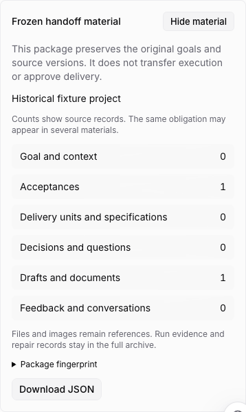
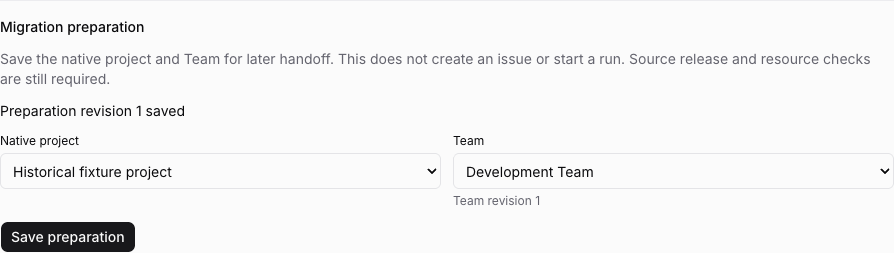
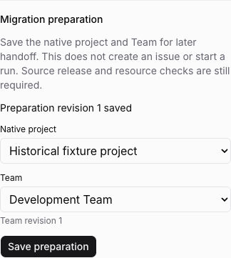

# LoopWork historical records

The migration tool captures the current shared LoopWork business database and
independent management database as local, queryable history. It does not create
Multica issues, bind a Team, resume a native claim or grant completion authority.
Unfinished source tasks keep LoopWork as their owner until an explicit cutover.

## Capture and inspect

Run from the Multica fork with Node's SQLite support:

```sh
node scripts/migration/loopwork-history.mjs capture \
  --source-root /absolute/LoopWork \
  --data-root /absolute/LoopWork/data \
  --output /absolute/migration/loopwork-capture
node scripts/migration/loopwork-history.mjs verify \
  --archive /absolute/migration/loopwork-capture
node scripts/migration/loopwork-history.mjs record \
  --archive /absolute/migration/loopwork-capture \
  --table tasks --id original-task-id
```

Paths must be absolute. Select the actual data root explicitly; the tool does
not load `.env` files, discover providers or start either application. This
version supports the source's shared `loop-ui.db`, application `loopwork.db`
and optional independent `admin-management.db` layout. A deployment using a
custom global-database filename needs explicit support before capture. The
tracked source checkout must be clean; its exact Git commit is recorded.

The output must be new and outside both source roots, including paths through
symlinks. Failed captures remove only their private staging directory. Existing
archives are never overwritten. The archive directory is private (`0700`), with
`0600` files. Keep it with the local migration artifacts, outside Git.

Only byte reads touch the source databases. The tool fingerprints the database
and WAL, copies them, compares copied/source fingerprints and rechecks the whole
cohort before publication. A rollback journal, changing source, missing required
schema or task without its project owner refuses capture. SQLite reconstructs
shared memory, validates and checkpoints only the private copies. The final
archive contains self-contained business/management databases and a hashed
manifest; it does not depend on the source WAL or recreate source directories.

## What is preserved

The manifest records every archived table's row count, columns and original
primary keys, projects, task states, source-run facts, unfinished task IDs and
legacy-import lineage. Original contracts, documents, conclusions, drafts,
questions, decisions, observations, receipts, comments, reading acknowledgements,
runtime history and repair provenance remain in their original database rows.
Database fingerprints protect their exact captured bytes. `verify` checks both
the files and the record inventory before lookup.

`record` accepts exact original IDs, including non-UUID and UTF-8 IDs. Supported
lookup tables are `tasks`, `documents`, `stories`, `agent_work_drafts`,
`command_chain_drafts`, `business_analysis_drafts`, `execution_attempts`,
`repair_cases` and `repair_observations`. Repair records are read from the
separate historical management database. Unknown tables are refused, IDs are SQL
parameters, and an absent record returns `null`. SQLite integers use lossless
`{"sqlite_integer":"..."}` JSON values; blobs use `{"sqlite_blob":"..."}`.

Application configuration gets schema/count inventory and the configured
workspace root only. Its database payload is excluded from the archive.
Application runtime credentials need a separate explicit configuration migration.
Historical business/management payloads remain private historical data; old
credential hashes and private prompt/tool content may occur there. Record lookup
omits top-level credential/token columns. No old token, lease, runtime selection,
controller or management intent is installed into Multica.

Already merged legacy project databases are identified through the current
business database's own import records, preserving those original paths and IDs.
They are not imported again. Other `.db`/`.sqlite` files at the data root and one
project-directory level are listed as unclassified. This is a bounded inventory,
not a claim that every historical deployment or backup has been found.

## Actual local capture

A read-only capture of the pinned LoopWork baseline
`17982f2b93100b42d65ed650869c9cc97ff92b5a` produced:

- Business: 95 tables, 123,139 rows, 4 projects and 38 tasks; 8 tasks remain
  unfinished. The source's `ready_to_close` and waiting states are preserved.
- Management: 46 tables, including 2 repair Cases and 4,377 original observations.
- Original content includes 197 documents, 30 command-chain drafts, 12,113
  execution receipts, 280 execution attempts and 107 runs.
- Four already merged legacy project sources are identified; twelve other
  database files remain unclassified. No native task was created.

The archive manifest is content identity
`6d2fef8e221d3dfc1b46c61201c41b265febc2715e73184b98bce4cdb0420d62`.
The validated local artifact is kept under the persistent
`~/.multica/migrations/loopwork/20261117-01` directory, outside managed environment
expiry and deletion. Its comparison report is stored alongside that directory.
The capture command reports its selected output path; archives can be relocated
without changing content identity. `verify` and exact-ID
lookups were exercised on this actual capture. A separate full-record comparison
checked all 141 business/management tables and 127,523 rows, ordered by original
primary keys, using framed lossless row hashes. Source database/WAL fingerprints
were unchanged before and after that comparison. Its report pins this exact
archive hash; no native execution ownership was transferred. These counts
describe that snapshot, not future source state or completed cutover.

## Native browsing

Local single-user deployments can opt into native history with both settings in
the managed environment's private configuration:

```dotenv
MULTICA_LOOPWORK_HISTORY_ARCHIVE=/absolute/migration/loopwork-capture
MULTICA_LOOPWORK_HISTORY_HASH=the_exact_hash_from_manifest
```

Use the actual 64-character manifest hash, an absolute persistent archive path,
local authentication and the engineering worker. Restart the API after changing
these settings. The archive remains outside managed environment expiry.

In Web and shared Desktop routing, open **Work → LoopWork history**, select a
source project or search its tasks, then open the task and its original document.
Task/document selection is in the URL, so refresh, direct links and browser Back
retain the source identity. Project/Team preparation is a separate native write
below the frozen material; issue adoption and exclusive execution handoff remain
incomplete. Installed Desktop acceptance remains outstanding.

The authenticated native routes are:

- `GET /api/engineering/history/availability`
- `GET /api/engineering/history?project_id=...&search=...&offset=...`
- `GET /api/engineering/history/tasks/{original-id}`
- `GET /api/engineering/history/tasks/{original-id}/documents/{original-id}`
- `GET /api/engineering/history/tasks/{original-id}/packet`

Only the reserved local human and local workspace can read this deployment's
archive. Other members/workspaces and task/cloud machine credentials cannot
consume it. Requests cannot select a filesystem path or archive hash. The host
pins the configured identity, the private history reader revalidates archive
files/inventory on each read, and Go checks the response identity. This worker
mode does not initialize engineering storage or accept execution commands.

Shared API clients send an explicit workspace identity, with query caches scoped
to both workspace and user. Navigation and command-palette entries follow the
same authenticated availability. Historical source state is displayed as history;
there is no run, Team reassignment, answer or Done operation. Reports preserve
the original text and revision. Markdown images remain labelled references until
external files are migrated; they are not automatically fetched. The source-text
disclosure retains original image/file references without executing them.

Controlled browser evidence covers project filtering/search, task/report links,
refresh and Back, read-only controls and 1280/390-pixel layouts using fixture
content. A separate configured-browser scenario reads the actual pinned archive.
Native permission/hash tests and a real private-worker round trip cover the
backend boundary. An authenticated read audit compared all 4 projects, 38 task
records and 197 full documents with the actual archive, including task/document
scope, original text and revision. Archive bytes were unchanged. Its local report
is `~/.multica/migrations/loopwork/20261117-01-native-read-correspondence.json`.
These checks do not establish native adoption, provider execution or
packaged-client acceptance.

The screenshots below contain controlled fixture content only:


## Frozen task material

Open an original task and choose **Frozen handoff material → View material →
Download JSON**. The shared Web/Desktop page loads the package only on request,
shows material counts and source-project deletion, and records schema gaps.
Counts are source records, not unique obligations or a completion verdict.
The equivalent offline read is:

```sh
node scripts/migration/loopwork-history.mjs packet \
  --archive /absolute/migration/loopwork-capture \
  --expected-hash the_exact_hash_from_manifest \
  --task original-task-id
```

`loopwork-task-handoff-v1` projects 31 named source material tables: original
project/task context, acceptances, Stories and versioned specifications,
dependencies and delivery context, draft artifacts and decisions, business
analysis artifacts, questions/answers, full documents, feedback and context
conversations. Every indirect lookup follows the original task's draft, batch,
group or session. Dependency IDs remain references; unrelated task material is
not expanded. Original JSON fields remain exact text. SQLite integers and blobs
use the lossless tags described above. Missing tables/fields are explicitly
unavailable, never silently reported as an empty complete contract. Columns
outside the fixed projections are listed as omitted.

Each package retains the archive identity, capture time, source task/project IDs,
source terminal/deleted facts and explicit LoopWork ownership. Its SHA-256 is
over the UTF-8 JSON body without `hash`, recursively sorting object keys
lexicographically and preserving array order. No generation timestamp is added;
repeating a read of the same archive produces the same package identity.
The downloaded, API-validated representation preserves this canonical digest.

Exporting this material does not create a native project, issue, Team binding or run.
Old approvals, answers and completed drafts remain historical facts; they do not
authorize a new native workflow or Done. Execution receipts, attempts,
process/repair ownership and reading records remain in the complete archive,
outside this material projection. External files/images remain references;
neither their bytes nor their validity have been established by exporting JSON.
Tables outside these 31 sections still require explicit cutover reconciliation.

The actual local snapshot produced 38 private packages under
`~/.multica/migrations/loopwork/20261117-01-task-packets`. Its manifest records
all 38 package hashes and an independent source-field comparison of 1,484
project/task/material rows across 31 sections per task. All projected fields
match and archive bytes remain unchanged. Four of the eight unfinished source
tasks belong to the active project; the other four belong to deleted projects.
Those deleted-project tasks remain history, without automatic reactivation.
This is frozen migration preparation material. Native project/Team proposals
can now be saved separately, while native issue correspondence, exclusive
ownership transfer and end-to-end cutover remain incomplete.

Controlled browser checks cover material expansion, 1280/390-pixel layouts,
actual JSON download, lossless versions and independent digest recomputation.
The screenshots below contain fixture material only:




## Native project and Team preparation

On **Work → LoopWork history → original task → View material**, use
**Migration preparation** to choose a native project and compatible Team, then
**Save preparation**. Creating the original project copies its name into a new
native metadata record; it does not copy repository paths into native resources
or discover/configure a runtime. Once a source project is mapped, its sibling
tasks reuse that project. A missing or unavailable target blocks preparation
instead of silently creating a replacement.

The local-owner routes are:

- `GET /api/engineering/history/tasks/{original-id}/preparation`
- `POST /api/engineering/history/tasks/{original-id}/preparation`

The write accepts only the expected preparation revision, packet hash, Team ID
and revision, plus a native project or an explicit create-project choice. It does
not accept per-task Agent/policy overrides, a caller-selected archive, a source
namespace or an execution owner. Source lookup is host-pinned and revalidates
the archive. A separate readonly worker action derives the source namespace
from the captured repository/data-root identity; moving the archive preserves
it, and a later capture of the same source can create a new preparation version
without duplicating project correspondence. Moving the source roots requires
explicit reconciliation rather than name-based matching. The existing v1 packet
and its digest remain unchanged by this lookup.

Native PostgreSQL stores one project correspondence per workspace/source/project
and append-only preparation versions per original task. A source-project lock,
project creation, correspondence and initial preparation commit together.
Concurrent siblings and unchanged acknowledgement retries reuse the project and
preparation IDs. Stale material, Team versions and preparation revisions are
rejected. Each preparation keeps the exact packet, native human and proposed
Team profile; later Team edits never rewrite that saved snapshot. Only the latest
matching proposal is labelled current. This describes proposal freshness, not
execution readiness. Deleting a native project or Team retains historical
provenance and makes the proposal unavailable/stale.

Current source-kind correspondences are `feature → develop`,
`business-analysis → business_analysis`, `end-to-end → end_to_end`, and
`bug → bug_fix`. Only compatible configured Teams are offered. Deleted source
projects, terminal tasks, incomplete material and other source kinds require
reconciliation; they do not fall back to Direct. The task selects a Team without
choosing its individual Agents.

Preparation always retains `source_owner: LoopWork` and
`execution_authorized: false`. It creates no native issue, run, Team task binding
or completion/reading record. Future activation must establish source release
and physical/resource ownership, reconcile the original material and required
external files, then freshly validate the native human, project, Team and
runtime. A historical answer or successful old execution is not new authority.

The actual pinned capture now has one native project correspondence and four
version-1 task preparations, using the Develop Team. The other four unfinished
tasks belong to deleted source projects and remain excluded. An authenticated
API/database audit compared every saved packet and Team profile, replayed the
same writes, and checked unchanged native issue/run counts and archive bytes.
Its private report is
`~/.multica/migrations/loopwork/20261117-01-native-preparation-correspondence.json`.
Isolated PostgreSQL tests cover sibling concurrency, replay, immutable versions,
stale scope, rejection rollback and missing targets; browser checks cover the
project/Team form and a real saved preparation. Provider and installed-client
acceptance remain outstanding. Screenshots contain fixture data only:





## Remaining cutover work

1. Reconcile and activate the saved source-task/project/Team preparations into
   native issues only after exclusive-owner cutover prerequisites pass.
   Historical statuses, answers and read acknowledgements cannot authorize a
   new workflow or Done; the preparation record is not execution authority.
2. Drain or explicitly reconcile every unfinished source task. Source database
   rows reporting stopped/exited do not independently establish physical exit;
   retain process/resource ownership gates before assigning work to Multica.
3. Materialize external run/evidence files and attachments with their source
   references, and classify remaining historical database copies. Database
   archives alone do not include those external files.
4. Extend task/document browsing to other history surfaces and establish
   source-project/task correspondence with native records. Verify the selected
   correspondence before adopting tasks; a historical record is not a native
   engineering result.
5. Complete explicit configuration migration, a target backup/restore and
   rollback exercise, exclusive-owner cutover, real-provider acceptance and
   packaged-client acceptance. Keep the original source available until these
   checks pass.

Controlled tests cover committed WAL capture, unchanged source bytes,
application-credential exclusion, original IDs and lossless integers, stale
sources, source-path protection, dangling ownership, malformed databases,
corruption refusal and CLI lookup. They do not prove live ownership transfer,
external-file completeness, provider behavior or packaged cutover.
