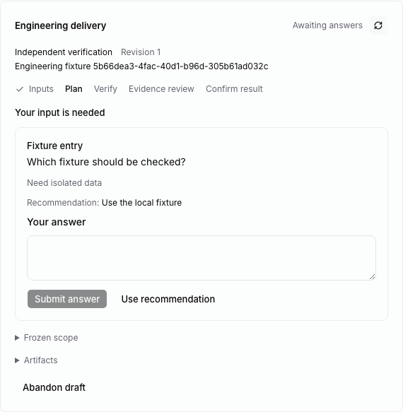
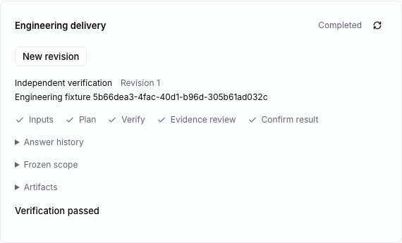

# Human engineering controls

With `MULTICA_ENGINEERING_ENABLED=true`, the shared Web/Desktop issue detail
includes engineering delivery controls. The local single-user session provides
the normal authenticated workspace member; answers are attributed to that member.
Mobile has its own client and does not yet include these controls.

## Configure and run

On an accepted, open issue, choose **Configure delivery**. Set the repository
path on the API host, choose an independent verifier, and add observable scope
items with their judging criteria. At least one acceptance is required. Enable
development to choose a different developer and supply implementation guidance.
Development command receipts currently require a Codex runtime. **Continue
automatically** authorizes development handoff and answered-question continuation;
turn it off for manual control. Freezing resolves
the actual clean Git HEAD and retains the source references and contract revision.

Bind the issue to a project with exactly one local-directory resource for the
selected agent runtime's daemon. The runtime must be local. **Start run** and
**Continue run** validate that mapping against the frozen repository before
queueing the configured role through Multica's existing task service. An active
issue run blocks another engineering run. Dispatch preserves the issue's assignee
and status. The daemon still has to bind the real execution directory before the
agent can use engineering commands; see [repository binding](repository-binding.md).

The panel shows the current role, revision, phase progress, frozen scope,
artifacts, and conclusion. Its server state uses workspace-scoped queries.
Unknown server states remain readable without enabling execution controls.
Unavailable or malformed responses surface an error instead of guessing that
execution is safe.

## Answer and continue

When a phase publishes its question batch, the panel shows the question, reason,
and any recommendation. **Use recommendation** only fills the input. **Submit
answer** records the explicit text with the authenticated human's identity and
the current sequence. Failed requests retain the text for correction or retry.
Answers and superseded questions remain available in the history.

After every active question is answered and the previous task has finished,
**Continue run** queues the frozen role. With automatic continuation enabled, the
[host coordinator](automatic-continuation.md) queues it without another click. Its new task claim resumes the same draft
and unfinished phase. Questions still being edited by an interrupted agent are
not yet published to humans and do not prevent that agent from recovering.
Partial development edits can survive such recovery; independent verification
and the final development handoff still require their checked clean commit.

**Abandon delivery** requires a reason, retains existing records, and makes a
new contract revision possible. The panel disables abandonment while a run is
active; abandonment does not cancel a native task or provider process. Completed
or abandoned deliveries can freeze a new revision on an open issue. Checkpoints
reject stale sequence/revision submissions rather than rewriting current work.

## Verification and limits

`e2e/engineering-panel.spec.ts` uses the running local Go API, the built native
CLI, the actual Node worker/SQLite store, a clean temporary Git repository, and
Chromium. It configures verification in the issue UI, queues a task, publishes a
question through the CLI, records a human answer in the UI, queues continuation,
and verifies that the same draft/phase and answer survive. A browser observes the
committed fixture before the CLI completes verification. Desktop-width and narrow
web layouts are captured. The test's runtime/task claims are owned fixture rows;
it does not launch an installed provider or call a model.

Core tests cover response validation and wire contracts. Shared component tests
cover answer/abandon/configuration errors, explicit recommendation use, unknown
states, and Chinese copy. Backend tests cover human-only controls, selected-role
dispatch, daemon-specific project resources, and refusal while a run is active.
Kernel tests cover repository preflight and interrupted development recovery.

The shared component is wired into Web and Desktop issue detail; the packaged
desktop app has not been exercised. Automatic development handoff and answered
question continuation are connected. Bounded failure/rework orchestration, the remaining command chains,
remote repository mapping, and real business/provider acceptance remain pending.
SQLite checkpoints, PostgreSQL queue admission, and filesystem checks are separate
operations; these controls do not establish a cross-database transaction or global
exactly-once execution. A successful task process alone is not a delivery verdict.
