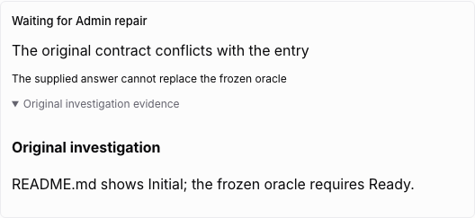
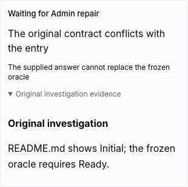

# Terminal intervention handoff

A role can surrender its current execution when it cannot reliably reconcile an
observed blocker with the frozen contract. The source entry is
`agent-intervention-request.ts`, with authorization in `agent-command-drafts.ts`
and result application in `agent-results.ts`, at the pinned LoopWork baseline.

## Current source routing

Role requests use arbitration authority and become `agent-fault` interventions.
The current source writes a durable `repair_observation_outbox` entry with the
original contract, then transfers it to the independent Admin management store.
`claimNextIntervention` excludes these faults, and `authorizedIntervention`
rejects the old system-assistance credential for them. Recreating the earlier
three-assistance-attempt loop would therefore route current faults incorrectly.

The target implements the terminal handoff and immutable pending observation.
The independent Admin controller, investigation/diagnosis, repair workspaces,
separate verification, resource takeover, business recovery and runtime update
are not yet connected. Pending handoffs intentionally remain blocked until that
path is implemented. No text resolution or ordinary Continue action substitutes
for verified repair or arbitration.

## Agent protocol

Read the current editable checkpoint with `engineering start` / `status`; Direct
must first use `direct-run`. Complete work through its normal terminal command
when possible. To surrender execution, save three UTF-8 files inside the native
task-private TMPDIR and run:

```sh
multica engineering intervention-request \
  --summary-file "$TMPDIR/summary.txt" \
  --reason-file "$TMPDIR/reason.txt" \
  --evidence-file "$TMPDIR/evidence.md"
```

The summary, reason and evidence are trimmed, required, and limited to 4,000,
8,000 and 100,000 JavaScript UTF-16 code units respectively. Identity comes from
the current native task credential and claim; the caller cannot choose another
issue, draft, phase, agent or attempt. Requests before viewing the editable draft,
after a terminal result, or while waiting for ordinary answers are refused.

The accepted response names `owner: admin` and `agent_action: end_execution`.
End execution immediately and preserve the workspace. Native directory locks are
released by normal process teardown, not by pretending that a still-running
process has stopped. This increment neither starts a model nor forcibly ends a
provider process.

## Persistence and gates

The request freezes the raw checkpoint, definition, contract, draft sequence,
phase and attempt together with the original reason/evidence and fingerprints.
A private SQLite transaction rechecks the current draft sequence or Direct
version and inserts the immutable terminal receipt. That same row is the durable
pending Admin observation with a stable observation ID. Repeating the same
request returns the same receipt; altered content is refused.

Readonly repository drift remains reportable after the authenticated editable
checkpoint was viewed. Surrender captures the persisted draft without rerunning
normal repository validators that may themselves be the blocker.

The separate viewed-checkpoint record proves that the current attempt previously
read its editable scope. The request's internal validation read does not create
that authorization. After handoff, task reads return the frozen snapshot and the
instruction to end execution, even if later workspace changes prevent ordinary
readonly verification.

The application rejects edits, new bindings, manual continuation, reconfiguration,
completion and verified-binding lookup on the surrendered issue. SQLite draft
and workflow-root writes also reject pending handoffs, including a writer that
read before the request. Continuation scans exclude held roots. Existing rework
budgets and original evidence remain unchanged. The synchronous native Done guard
uses the same blocked completion boundary.

The shared Web/Desktop panel shows the original summary, reason and Markdown
investigation evidence, with the current phase retained and continuation controls
unavailable. It does not display the request as a human question or a passed test.

## Verification boundary

Kernel tests cover Direct and editable YAML handoff, immutable receipt replay after
reopening SQLite, attempt/agent/human boundaries, source text limits, preserved
drafts and stale writes. API and CLI tests exercise native identity derivation and
UTF-8 task-private files. Core/UI tests cover malformed projections, retained
investigation evidence and blocked continuation.

The controlled browser run passed both Direct and verification paths in 38.2
seconds, including readonly workspace drift after status viewing. It uses the
real API, private worker, native task credentials, management CLI and shared UI,
with fixture-native runs and no provider process. Screenshots at 1280 and 390
pixels were inspected. No real-provider or packaged Desktop acceptance is claimed.
The complete Admin repair path remains in the migration coverage audit.







## Remaining independent Admin acceptance

The current source requires these separate proofs before the full path can be
called migrated:

- An observation bridge must ingest the same immutable observation before
  acknowledging business linkage; interrupted cross-store handoff reuses the
  observation ID (`repair-observation-bridge.ts`).
- Management supervision has its own authority token, process identity and
  physical-exit confirmation, independent of business readiness and normal agent
  slots (`admin-controller.ts`).
- The Admin command boundary permits status/history, scoped workspace takeover,
  repair-workspace/build requests, evidence recording and structured submission.
  It cannot directly complete Dev/Test or close a Case (`admin-command.ts`).
- Diagnosis and repair need independent verification of original observations,
  actual versions and acceptance coverage. A successful Admin exit is not a
  persisted verification receipt (`admin-management-store.ts`).
- Repeated failures change investigation method and may select only configured
  alternative runtimes. A fixed failure budget cannot turn an agent fault into
  a human-input request (`repair-recovery-policy.ts`).
- Only verified management facts may drive trusted business handoff, readiness
  observation and runtime updates, with version/coverage checks and retained
  failure evidence (`admin-handoff.ts`).
