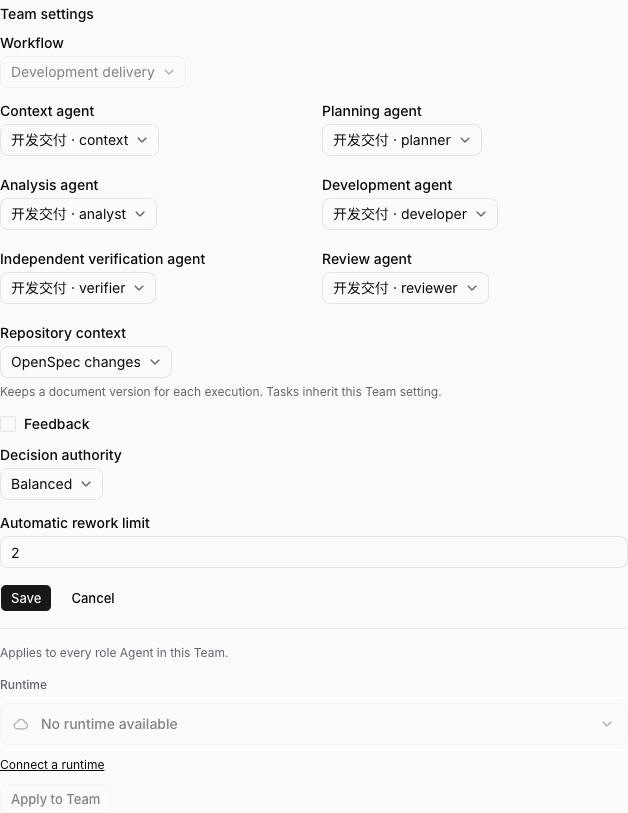
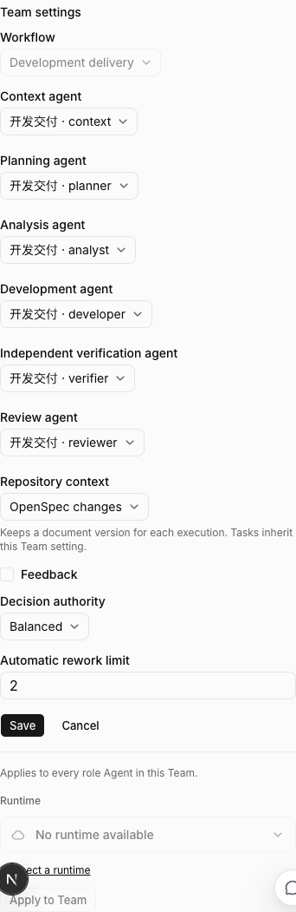

# Team-owned OpenSpec repository context

Tasks keep selecting one Team. A Develop, Bug Fix or End to End Team can choose
**Repository context → OpenSpec changes** in its existing Team settings. This
setting is frozen with the Team revision at task start; it adds no per-task Agent,
pack or workflow selection. Direct and standalone Business Analysis do not expose
this delivery setting. The End to End business-analysis stages keep their normal
inputs; its six delivery stages use the configured repository context.

中文路径：**Team → 对应 Team → Team 设置 → 编辑 → 仓库资料 → OpenSpec 变更文档**。
The shared component serves Web and Desktop. Native API management retains its
normal roster, membership, decision-policy and revision checks. Older profiles
keep the field absent and retain their existing serialized definition; enabling
or removing it creates a new Team revision and does not change started tasks.
Existing migrated task preparations are not upgraded automatically.

## Source contract

At the pinned LoopWork source commit, five of the six parsed OpenSpec YAML
variants equal their default definitions. The requirement-context variant changes
only the AS-IS instruction. None of those six files declares a repository
Artifact adapter. The active source behavior in `src/application/agent-context.ts`
is its configured context adapter: expose Markdown under each active
`openspec/changes/<change>/` directory as repository resources, excluding `archive`
and hidden top-level change directories. A duplicated set of six YAML files or
a generic repository-artifact parser would not establish that behavior.

The target therefore keeps the normal native protocol definitions and migrates
that active document-reading behavior into a Team setting. Arbitrary legacy
per-Agent configuration, custom repository Artifact writing and an OpenSpec CLI
installation/launch are outside this feature.

## Frozen native reads

The optional wire field is `definition.context_adapter: "openspec"`. Its absence
keeps normal behavior. After the selected native task has successfully bound and
read or started a context, planning, analysis, development, verification or review
checkpoint, its response includes `repositoryContext`:

- the native workspace, issue, attempt and Agent identity;
- the frozen Team binding/revision, contract revision and code version;
- the exact daemon-bound execution directory, including a managed child worktree;
- each document's original `REPO:OPENSPEC:` reference, relative path, SHA-256 and
  Markdown text, plus the snapshot hash and capture time.

Two matching reads of the entire selected file cohort precede persistence in
`engineering_repository_context`. The same native attempt reuses its original
version, including after process/storage reopen; it cannot move to another role,
root, Team or contract/code version. A later attempt captures its own version
only after normal native repository/claim checks succeed. Team edits affect new
tasks. Managed units inherit the parent's frozen Team setting.

The physical execution binding chooses the root. Callers cannot submit a path,
plugin script or adapter name to task reads. Material must be regular UTF-8
Markdown within the authorized root. Linked directories/files and special
objects are refused. Capture allows at most 256 documents, 256 KiB per document
and 512 KiB total; excess material is refused rather than truncated. An absent
OpenSpec directory produces an explicit empty resource list. Archived/hidden
change roots and non-Markdown files remain outside this source scope.

Documents are labeled `source_material`. Normal context decisions, frozen
acceptance entities, independent verification, report reconciliation and human
reading gates stay authoritative. Conflicting proposals still require the normal
question/decision path. Context capture does not launch a model, create an
acceptance, authorize a file write or establish a successful delivery. The
original snapshot also remains in an intervention handoff if current readonly
files later change.

## Controlled verification and remaining acceptance

Storage tests cover exact bytes/references, ignored archive/hidden changes,
snapshot reopen/replay, new-attempt capture, malformed/oversized/linked material
and changed role/root/Team/code scope. Native Team-start tests cover binding
requirements, frozen Team edits, wrong-role refusal and retention through
intervention after the live document changes.

The existing complete Bug Fix Team scenario now enables this option in both
in-place and worktree modes. Its context/planner, two managed deliveries and
final reviewer retain all six kinds of repository snapshots while the normal
independent verification and exact human reading gates still precede completion.
The reviewer uses its actual worktree binding. Native handler tests retain human
management/roster enforcement and reject unsupported adapter names or workflows.
Shared UI tests cover saving the setting with the Team definition and locale
parity. A Chrome browser check covers selecting, saving and removing the option
at wide and narrow widths. Its PUT response is a browser-only fixture; the real
staged Team profile is compared before and after and remains unchanged. Backend
persistence and authorization are covered separately by the native handler and
kernel tests. These are controlled protocol/application checks, not real-provider,
semantic specification-quality or packaged-client acceptance.

The local staged migration cohort keeps its original default Team revision and
unbound runtime roles. No source Agent configuration or installed provider account
is read or installed by this feature. Real OpenSpec task/provider acceptance and
explicit reconciliation of any legacy per-Agent configuration remain pending.
