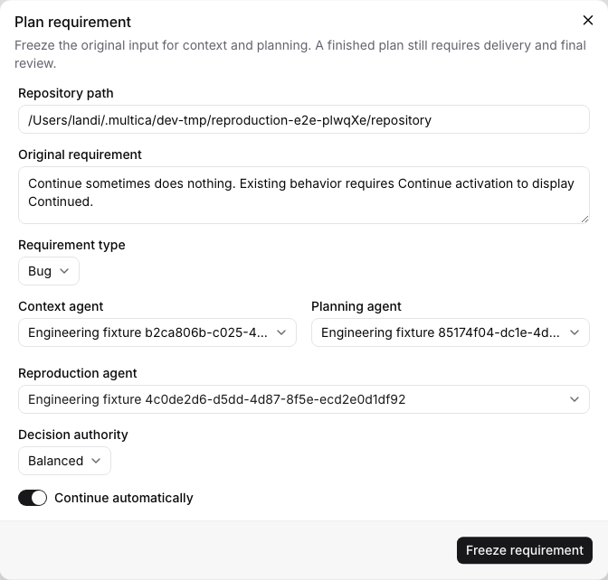
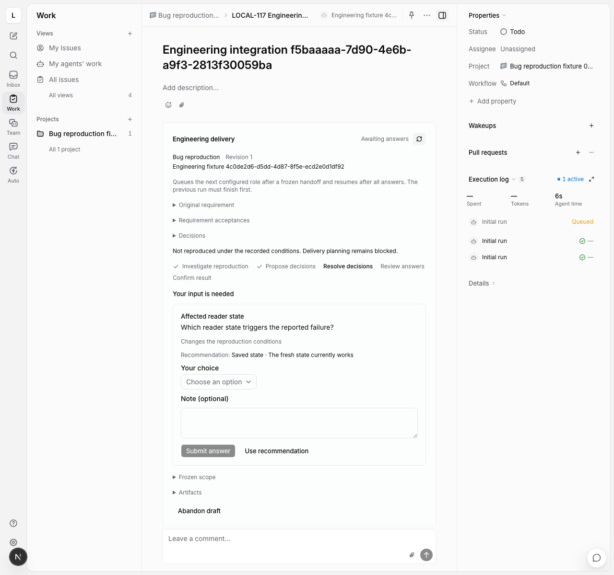
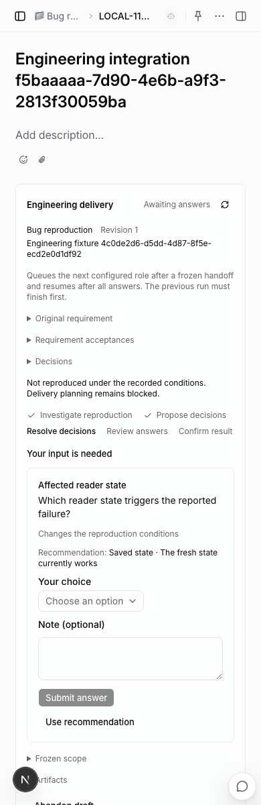
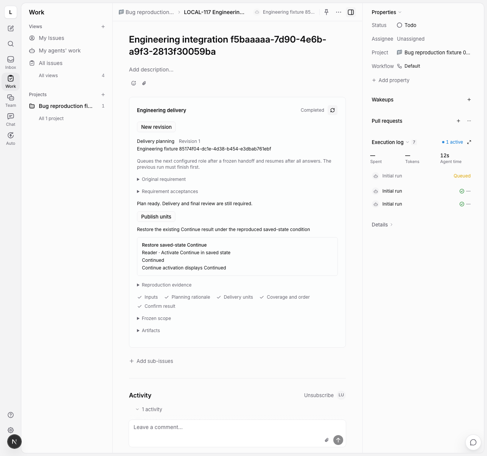

# Bug Fix reproduction

Bug requirements now pass through context → reproduction → delivery planning.
The fork imports the source `command-chains/default/repro-agent.yaml` with the
same artifacts, phase order and instructions; only comments are translated.
Ordinary requirements keep their context → planning route.

## Frozen scope and admission

Bug configuration requires a separate reproduction agent, distinct from context
and planning. Go resolves that agent in the authenticated workspace before the
private worker accepts configuration. Each run rechecks native invocation rights,
project resources, lifecycle and unfinished prior tasks through the existing
engineering run/continuation service. No login or credential boundary changes.

Completed context freezes its full conclusion and fingerprint, existing
acceptances, code version and canonical Existing Expected for reproduction.
Expected consists of the context's reliable `expected` assertions in order;
inferred or conflicted assertions cannot become the reproduction oracle. The
verdict must preserve that exact text. Reported Actual, independently observed
Actual and hypotheses remain distinct facts.

The daemon binds a local directory or pinned worktree at the frozen commit.
Agent operations reject persistent Git changes, changed runtime-owned files,
wrong repository/commit, stale role/attempt and changed context fingerprints.
Final handoff rechecks the completed run's bound repository. This is a protocol
check at operation boundaries, not an operating-system filesystem sandbox.

## Investigation, questions and renewed observation

The imported chain has five phases:

1. `investigation`: record verdict, Expected/Actual, environment, stability,
   impact scope, steps and locatable evidence. Hypotheses are optional.
2. `alignment_proposal`: propose the complete set of missing factual choices.
3. `alignment_resolution`: preserve the original decision keys, request human
   facts and pause, then resolve using the authenticated selected options.
4. `answer_review`: review the combined effect of answers on conditions and
   observations. Rewind investigation when conditions change.
5. `finalize`: compile a complete `reproduced` conclusion for planning.

Only `not_reproduced` may ask for missing reproduction facts or pause on runtime
questions. A not-reproduced record cannot finalize, publish units or complete
the requirement. It is not a conclusion that the problem does not exist. The
configured decision authority still applies; fully autonomous mode cannot issue
structured `decision.ask` commands.

Human answers do not change the verdict or manufacture evidence. Verdict edits
belong to investigation, so changing `not_reproduced` into `reproduced` requires
rewinding and registering observations again. Rewind archives the old verdict,
steps, evidence and hypotheses in the durable draft before clearing the current
investigation. Authenticated decisions and question history remain available;
the next answer review must be written again. Prior records are included in the
compiled report as historical observations.

## Planning and later review

Successful reproduction appends frozen planning sources for Existing Expected,
current conditions/verdict, steps and observations, with reproduction draft and
revision provenance. Long source values are chunked rather than truncated.
Every source must be covered by a planned unit. Original acceptance identities,
revisions and oracles stay unchanged. The full reproduction report, including
historical observations and explicitly labelled hypotheses, is supporting
planning context; a hypothesis does not become an implementation obligation.

The reproduction conclusion and changed planning contract are acknowledged in a
SQLite transaction. A saved terminal reproduction can settle after reopening
storage without repeating its investigation, including when automatic continuation
is disabled; settlement does not queue a new role in that mode. Automatic
continuation uses the
existing stable native task identity and waits for the prior run to finish.
Native queue writes remain separate from SQLite checkpoint writes.

Final requirement review also retains the reproduction conclusion as supporting
evidence and reconciles reliable Existing Expected as original obligations.
Reproduction does not substitute for independent verification at the delivered
commit, a final review report or authenticated report reading.

## Controls and verification boundary

The shared Web/Desktop issue controls add the reproduction role for Bug Fix,
show unconfirmed reproduction and pending factual choices, and retain the
compiled report after planning starts. The existing human answer/resume and
management CLI operations are reused. Task credentials cannot answer their own
questions. Mobile retains its independent interface.

Kernel checks exercise reproduced/not-reproduced gates, missing observations,
unchanged Expected, authenticated choices, renewed investigation, preserved old
evidence, stale attempts and storage reopen. Host checks exercise both in-place
and worktree bindings, changed context/repositories, planning coverage, unchanged
original oracles and terminal handoff recovery. Native PostgreSQL checks cover
agent lookup, claim instructions, continuation admission and task identity.

The native browser fixture uses an actual page where Continue works normally
but fails in saved state. It observes both states, obtains the affected condition
through the human control, returns to investigation, and hands fresh evidence
to a native planner. Agent conclusions and semantic judgments are fixture
supplied; no installed provider/model is invoked. A real model's ability to
diagnose the condition, truth of arbitrary evidence text, packaged Desktop,
remote execution and a complete model-driven Bug Fix remain unaccepted.

