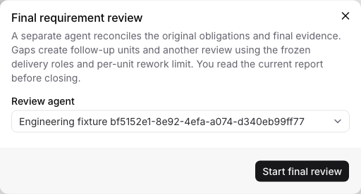
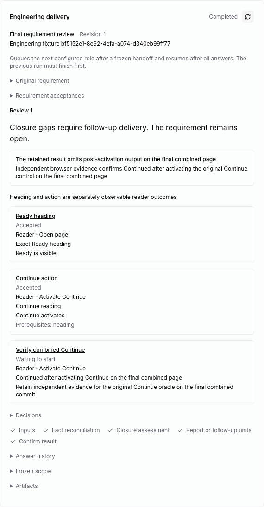
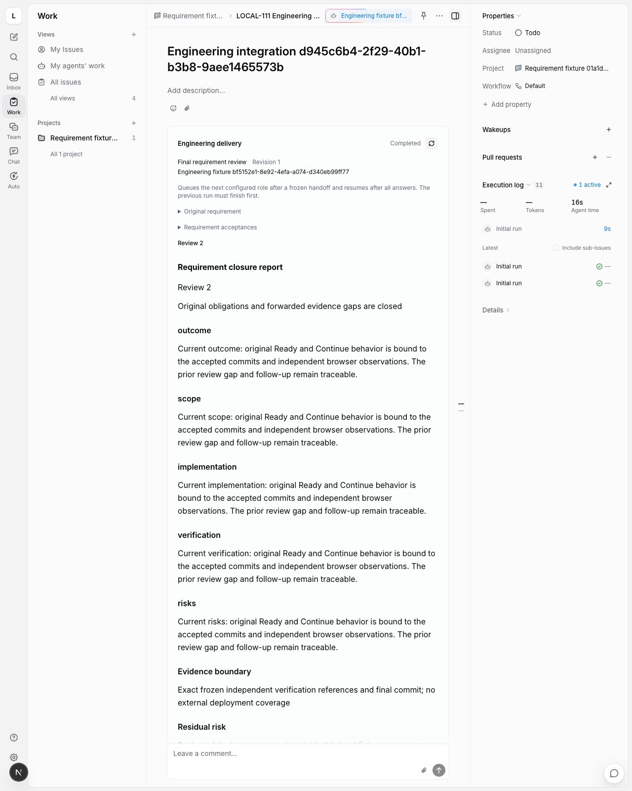
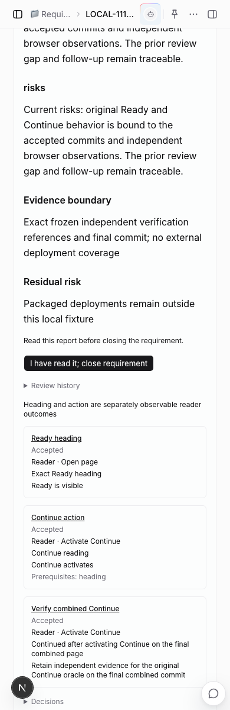

# Requirement final review and reading acknowledgement

The fork imports LoopWork's actual `command-chains/default/review-agent.yaml`
as `packages/command-chain/definitions/review.yaml`. Its phase order is unchanged:
inputs → fact reconciliation → closure assessment → report or forward delivery
units → finalize. The reviewer reconciles existing authoritative facts; it does
not run another Test pass or manufacture delivery evidence.

## Authorization and frozen inputs

After all published units are accepted, **Start final review** selects a reviewer
separate from the frozen analysis, development and verification agents. The
reviewer can reuse a context/planning agent. It must have an invocable native
local runtime and the same registered project repository and execution mode.
Authorization also covers automatic delivery of declared closure gaps and fresh
review generations, using the existing delivery roles and per-unit rework limit.
That limit bounds a unit's rework, not the total number of review generations.

The host derives the final code version from the last accepted unit. Every prior
accepted commit must be its ancestor. In-place review requires that exact clean
HEAD; worktree review uses a runtime binding at that commit. Scope contains:

- The original business intent, targets and resolved business impacts.
- Reliable Existing Expected for bug requirements, with reproduction history
  retained as supporting facts rather than delivered-commit Test evidence.
- Permanent requirement acceptances with their exact revisions and oracles.
- Every delivered unit's frozen meaning and resolved analysis contract.
- Actual passed independent verification conclusions, including scenario/result
  evidence and tested code bindings.
- Earlier completed review conclusions and their forward obligations.

Subjects and evidence-source fingerprints are projected as readonly artifacts.
Full evidence content and required verification references remain in the returned
contract. Each operation rechecks those facts and the bound readonly repository.
A stale accepted version, changed fingerprint, missing specification or changed
code prevents review from proceeding. The host does not infer a composed final
behavior merely because individual unit verifications passed.

The native host also checks that children are actually Done, retain their frozen
origin metadata, and belong to the same parent, workspace and project. Deferred
and active child runs block admission. Parent closure blocks new review claims
and commands. The private Node worker receives identity facts, never credentials.

## Fact reconciliation and output gates

Every subject must have exactly one reconciliation or one closure gap. A
reconciliation must reference known frozen evidence and every independent Test
reference required by that subject's delivery scope. Requirement-wide subjects
require all units; an acceptance requires the units carrying its exact canonical
acceptance reference. Development claims and supporting context cannot replace
these references. Reference and version checks do not prove natural-language
relevance, semantic completeness, or the reviewer's judgment.

The assessment records a requirement-level summary, evidence boundary and any
residual risk. A condition that still prevents closure belongs in an explicit
gap, rather than only in risk text.

There are two exclusive deterministic outputs:

| Output | Required facts | Result |
| --- | --- | --- |
| `report_ready` | No gaps; canonical outcome, scope, implementation, verification and risks sections | A source-bound report awaiting authenticated reading |
| `closure_gap` | Complete forward units; each gap covered exactly once; known, non-self, acyclic dependencies | Follow-up delivery while the parent remains open |

Unknown subjects/references, duplicate handling, mixed report/gap output,
uncovered gaps, and incomplete forward units are rejected. Finalization repeats
the input, reconciliation, assessment and output checks.

## Forward delivery and recovery

Completed review gaps settle into stable managed unit IDs before native issue
creation. Dependency order is topologically derived, and the new units append
after existing accepted work; the original planning generation is not rewritten
and Story Splitter does not rerun. Gap boundaries become permanent requirement
acceptances. A gap against an existing acceptance also preserves its original
oracle in the new unit. Full subject context is retained in bounded source
chunks; oversized unit context must be split rather than silently truncated.

The native coordinator publishes these units through the same idempotent issue
service and per-child acknowledgements used for initial publication. It waits
for the reviewer run to end before forwarding. Subsequent units use the existing
analysis → development → independent verification chain and actual accepted
predecessor commits. Once all units are accepted, a fresh review generation
freezes the new evidence and prior review history under the authorized reviewer.

SQLite stores the completed checkpoint, stable append intent and history. A
terminal checkpoint can settle after reopening storage. Native publication and
its SQLite acknowledgement remain separate commits with retryable identities;
this is not a cross-database transaction or general exactly-once execution.

## Report reading and completion

The report panel renders the current source-bound report and keeps prior review
generations available. Reading is an explicit human fact, separate from
`report_ready`, provider process exit, and issue assignment.

**I have read it; close requirement** submits the exact requirement revision,
draft sequence and report hash. The host records the authenticated user, hash,
sequence and acknowledgement time. Task credentials cannot perform that action. A stale
hash or changed repository/frozen evidence is rejected.

After reading is recorded, the native handler uses the ordinary synchronous
completion writer. It rechecks child ownership, origin, Done states and all
unfinished runs, preserves the parent fields, then writes native Done. If native
completion fails after the reading acknowledgement, retry revalidates the same
report. Repeating an already successful acknowledgement does not publish a new
completion snapshot. Other status-write paths also require the current reading
fact and native child proofs, so direct Done writes do not bypass this boundary.

The human management CLI exposes the same controls:

```sh
multica engineering start-review <requirement-id> --payload-file review.json
multica engineering acknowledge-report <requirement-id> --payload-file reading.json
```

`review.json` contains `expected_revision`, `expected_sequence`, and `agent_id`.
`reading.json` contains `expected_revision`, `expected_sequence`, and
`report_hash`. Repository resources, child proofs and user identity are supplied
by the host. Runtime questions use the existing authenticated answer/resume path.

## Verification and limits

Kernel checks use real SQLite and Git repositories for report compilation,
per-subject verification scope, stale facts, gap forwarding, permanent original
oracles, storage reopen, subsequent review, reading attribution, and changes
after reading. Both in-place and worktree host paths are exercised. Native
PostgreSQL checks cover child origin/lifecycle, unfinished runs, claim role
instructions and reading before guarded parent completion.

The controlled native requirement scenario uses the actual UI, scheduler,
management CLI and Node worker. It deliberately retains insufficient composed
activation evidence, declares a review gap, observes automatic native follow-up
publication, adds a scoped regression check, obtains fresh Chromium evidence,
generates another review and closes through authenticated report reading. Review
judgments are fixture-supplied; this does not prove a real model detects missing
evidence. No installed provider or model is invoked by that scenario.

A separate browser layout regression uses a fixed report response, real pointer
wheel scrolling and a mocked reading endpoint to check that a long report's
reading control remains reachable after switching to a narrow viewport. Its
acknowledgement check is UI coverage, separate from the native completion proof.

Delivery feedback now hands off after independent per-comment verification to a
fresh normal review with pinned feedback history and exact new report reading.
An old report acknowledgement cannot close appended feedback deliveries.

Report-correction mode, arbitration exceptions, published-plan
reconciliation, exhausted managed-budget recovery and cross-parent repository
admission remain separate migration work. Packaged Desktop, native multi-unit
worktree execution and real-provider acceptance remain unverified. Mobile keeps
its independent interface.








