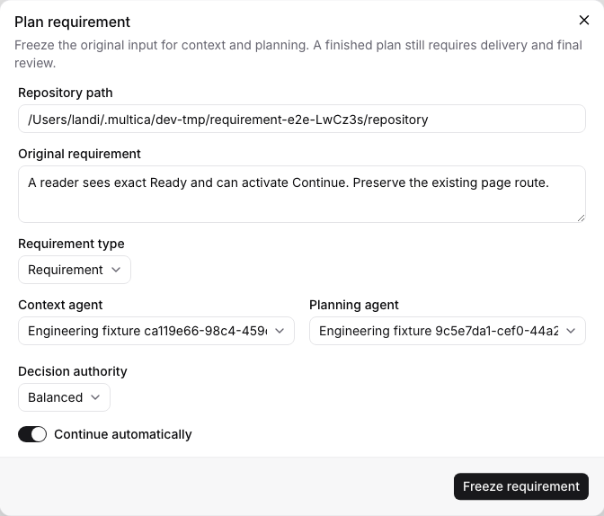
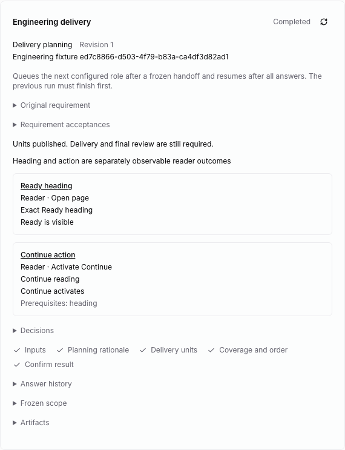
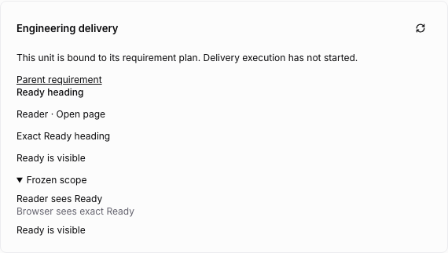
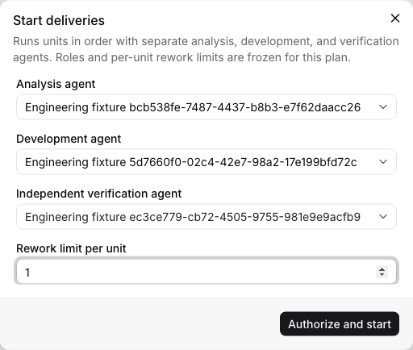
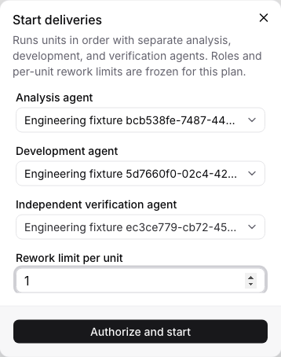
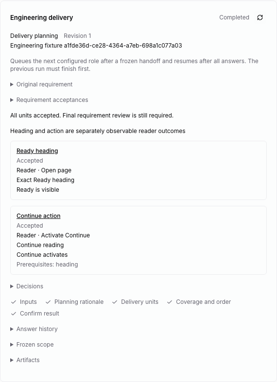
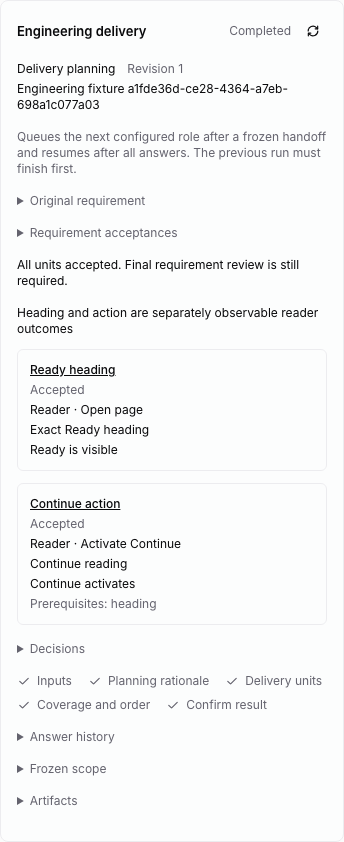
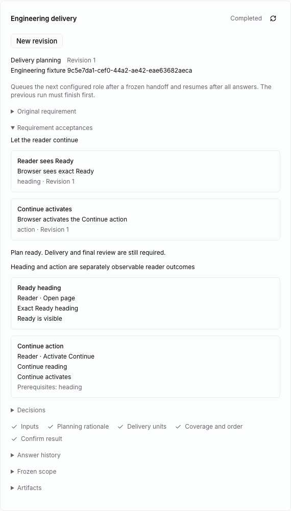
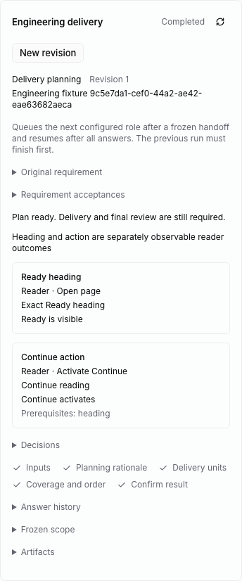

# Requirement context and delivery planning

The fork imports LoopWork's `backlog-agent.yaml` and
`story-splitter-agent.yaml` as `definitions/context.yaml` and
`definitions/planning.yaml` in `packages/command-chain`. These retain the
original phase order and builtin gates. The context definition explicitly
declares the host-owned acceptance projection's fields for the new loader.

## Configure and run

Choose **Plan requirement** in an unconfigured issue's engineering panel.
Freeze the original input, clean local repository, requirement/bug type,
decision policy, context agent, separate planner, and continuation policy.
Both roles use the existing native queue, claim identity and daemon-owned
repository binding. Their operations require the frozen clean commit; neither
role may use investigation as a route to changing business code.

The CLI uses the existing human configuration endpoint:

```json
{
  "kind": "requirement",
  "expected_revision": 0,
  "agent_id": "<context agent UUID>",
  "planner_agent_id": "<planner UUID>",
  "repository_path": "/absolute/local/repository",
  "input": "Original requirement and its sources",
  "item_kind": "requirement",
  "decision_mode": "balanced",
  "auto_continue": true
}
```

Initial execution requires **Start run**. With automatic continuation, a fully
answered context question batch resumes that same context draft/phase, and a
completed context queues the frozen planner after all native issue runs finish.
The native task row and deterministic checkpoint ID retain the existing
[dispatch guarantees and limits](automatic-continuation.md). Manual continuation
uses the same revision/sequence and repository preflight.

A single issue owns either a requirement workflow or an independently configured
delivery workflow. A caller cannot silently replace one with the other. Freeze a
new requirement revision only after its current draft is completed or explicitly
abandoned. Previous requirement/acceptance revisions remain stored.



## Context gates and acceptances

The context chain follows AS-IS, decision proposal, decision resolution, answer
review, TO-BE, impact scan, scope, acceptance definition, and finalization.
It requires intent, a reliable Actual, a reliable Target, a change summary,
resolved impacts, an included scope, and at least one acceptance. A bug also
requires reliable Existing Expected. Inferred statements cannot stand in for
those required reliable statements; conflicted assertions block completion.
Decision references must exist, every node must close, and a human resolution
must match the authenticated option snapshot. The authority modes and human
answer protections are shared with [delivery analysis](analysis.md).

Reliability labels, source relevance, product completeness, and consistency of
natural-language statements remain declared judgments. The host enforces their
structure and provenance; it does not prove their business semantics.

In the acceptance phase, use:

```json
{"type":"acceptance.put","acceptance":{"key":"reader-ready","statement":"The reader sees Ready","oracle":"A browser observes the exact Ready heading","source":"Original requirement"}}
```

`acceptance.remove` takes a `key`. Keys are stable, limited to 120 characters,
and use lowercase letters, digits, dots, underscores, colons or hyphens. `unit:`
is reserved for host-owned delivery acceptances. IDs, scope, publication state
and revision are assigned by the host; callers cannot supply them. The projected
`requirement-context.acceptance` artifacts are read-only. Rewinding before the
acceptance phase clears its draft entities; revisiting the acceptance phase
rebuilds its projection from the edited entities.

Publication gives each requirement acceptance a permanent UUID derived from its
workspace/issue/key. Its unchanged active meaning keeps the same revision.
Changes or reactivation increment the revision; removal retires the previous
entity in a new stored revision. Retirement does not erase history. Publishing
these entities, freezing planning inputs, and marking context handoff share one
SQLite transaction. A saved terminal context checkpoint can settle after a
restart without treating a native process exit as its conclusion.

## Planning gates

Planning inputs contain every resolved context impact and active requirement
acceptance. Impact references name the actual context draft/key. Acceptance
references name the permanent UUID and exact revision. The contract retains the
original acceptance oracle; the readonly planning projection follows the
original YAML's kind/content/sourceRef fields. Agents cannot replace these
frozen sources.

The planner registers a rationale, 1–50 keyed delivery units, overall coverage,
and ordering/dependency rationale when there is more than one unit. Each unit
has actor, trigger, observable outcome, acceptance meaning, source references,
and prerequisite keys. All source references must exist, all frozen sources
must be covered, and every unit must link a change or acceptance. Repeated
references, repeated dependency keys and duplicate unit titles are rejected.
Dependencies must exist, precede the dependent unit in the declared order, and
form an acyclic graph. The compiled plan expands references from the actual
frozen sources rather than trusting embedded source text from the planner.

Coverage is checked per source key. The host does not prove that a unit covers
every semantic clause inside a source or that units are independently useful.

## Native unit publication

After the plan completes and all parent runs finish, choose **Publish units**.
The human endpoint accepts only the current revision and sequence. It compiles
units from the stored completed plan, assigns stable native issue IDs, and
freezes each unit's sources, exact original acceptance oracles, provenance and
prerequisites before any native child is created. Each unit also has a host-owned
`unit:` acceptance from its planned acceptance meaning. Change/preserve/technical
planning references remain analysis inputs on the frozen unit, not improvised
verification oracles. Analysis later derives verification focus and guardrails.
Long source keys retain
the full planning reference; a deterministic bounded key identifies that source
inside the existing verification contract.

The equivalent native CLI command is:

```sh
multica engineering publish-units <requirement-issue-id> --payload '{"expected_revision":1,"expected_sequence":42}'
```

The snapshot owner can retry an interrupted publication. Each child uses the
normal IssueService creation pipeline for workspace/project/parent validation,
issue limits, numbering, properties, events and analytics. Its frozen native ID
and flat engineering origin metadata (`engineering.plan`, `engineering.unit`,
`engineering.revision`, `engineering.contract`) are stored in the same PostgreSQL creation
transaction. A replay reuses that identity after verifying its parent, project,
creator and origin; it does not allocate another issue number or adopt an
unrelated task with the same title. Each successful child is acknowledged in
SQLite. Pending children remain retryable after interruption. If a previously
acknowledged native child was deleted, retry requires reconciliation rather than
silently recreating it.

Publication freezes the requirement generation against replacement. Revising a
published plan needs a future explicit reconciliation path; creating a new root
must not silently orphan published units. Native children remain unassigned in
Todo, with automatic PR completion disabled. Their engineering panel shows the
frozen unit and prerequisites and links back to the requirement. Generic
configuration cannot replace their managed scope, and their done-status gate
rejects completion before independent verification. Publishing units does not
start a provider, prove prerequisite delivery, or complete the requirement.

SQLite intent, native PostgreSQL creation, and per-child acknowledgement remain
separate commits. Their persisted identities make publication retries reusable;
this is not a cross-database transaction or a general external-effects guarantee.





## Authorized serial execution

After every child is published, **Start deliveries** freezes a human-authorized
policy: three distinct invocable analysis/development/verification agents, a
rework limit of 0–10 for each unit, and their common registered repository and
execution mode. Each role must map to exactly one matching native local project
resource. The existing context/planning continuation switch does not authorize
implementation; starting delivery is a separate human action.

The management CLI exposes the same checkpoint:

```sh
multica engineering start-deliveries <requirement-issue-id> --payload-file delivery-policy.json
```

The JSON body contains `expected_revision`, `expected_sequence`,
`analyst_agent_id`, `developer_agent_id`, `agent_id` (independent verifier), and
`max_reworks`. The native API route is `POST /api/issues/{id}/engineering/delivery`.
Task credentials cannot authorize this policy or change managed scope.

The native coordinator activates units in the frozen plan order. Every preceding
unit must have an acknowledged passed verification binding; explicit dependency
bindings are also frozen into analysis. The first unit starts from the original
requirement commit; each later unit starts from its immediate predecessor's
actual accepted commit, including predecessors not listed as explicit dependencies.
An in-place repository must be clean and exactly at that commit. Worktree mode
selects the accepted commit while preserving the registered checkout and binds
runtime worktrees through the existing daemon repository protocol.

Each child uses the existing analysis → development → independent verification
chain, including authenticated human questions and bounded specification or
implementation rework. Published acceptance oracles remain authoritative. A native
process exit does not advance the plan. The coordinator waits for all unfinished
runs of the requirement and its children, including deferred runs, before dispatch.
Native role checkpoints retain stable task IDs across retries.

After passed independent verification and terminal native runs, the coordinator
checks completion synchronously, moves the child to native Done through the
common guarded writer, and acknowledges that exact verification binding on the
parent. If acknowledgement fails after Done, reconciliation retries acceptance
without recreating the child. Only then can the next unit activate. The parent
panel polls delivery progress and links to children for questions and detailed
history. Closing, cancelling or moving the parent to another project blocks new
child commands/claims/continuations; it does not terminate already-running OS
processes or roll back filesystem effects.

This serial scope is one requirement and its children. It is not an atomic
cross-parent repository lease, a PostgreSQL/SQLite/filesystem transaction, or a
global exactly-once guarantee. Simultaneous requirements sharing a repository
need a separate admission/ownership design before that usage is supported.

All accepted units still leave the parent completion gate blocked for final
requirement review. Published-plan revision, managed budget recovery and explicit
reconciliation after scope changes are not yet exposed; generic reconfiguration
must not replace managed scope.









## Verification and remaining integration

Kernel tests use real SQLite and temporary Git repositories to cover human
answer/resume, role handoff, reliable evidence requirements, frozen planning
inputs, invalid plans, acceptance revisions/retirement, and competing workflow
refusal. API/component checks cover wire mapping, malformed parent controls and
the distinction between a finished plan and delivered work. Go tests cover
context/planner claim instructions and planner visibility before worker access.

`e2e/engineering-requirement.spec.ts` configures the parent workflow through the
actual UI, observes the repository in Chromium, supplies a human option answer,
resumes through the native scheduler/CLI/worker, publishes acceptance identities,
plans two dependent units, publishes them as actual native children, replays
publication without duplicates, opens a child through the real UI, and proves
that parent and child completion remain blocked before delivery. Its task claims are owned fixture metadata; it
does not launch an installed provider or call a model.

Native child publication and authorized serial execution are connected. Kernel
tests cover two units in both in-place and worktree modes, actual Git commits,
SQLite reopen, frozen policy/mode/base refusal, and predecessor acceptance.
Managed PostgreSQL tests cover deferred sibling admission, native Done before
acceptance, acknowledgement recovery, and parent cancellation.

The native end-to-end requirement scenario also authorizes three separate delivery
roles through the UI, executes both published children through the native
scheduler/CLI/worker, captures actual development command results, and observes
the committed heading and Continue action in Chromium. It asserts the second
unit's actual predecessor commit, both native Done statuses, and the parent's
remaining final-review gate. It uses controlled task claims and does not launch
an installed provider or call a model.

Requirement final review, published-plan reconciliation, managed budget recovery,
and cross-parent repository admission remain integration work. Packaged Desktop,
real-provider acceptance, and native end-to-end multi-unit worktree execution
remain unverified. Web/Desktop share the controls; Mobile retains its independent
interface.





SQLite publication, PostgreSQL task admission and filesystem observations are
separate boundaries. No cross-database transaction or global exactly-once
execution is established by these checks.
