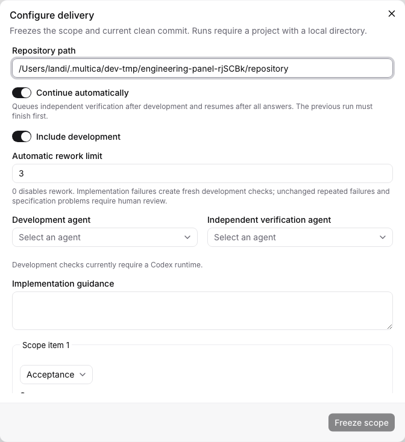
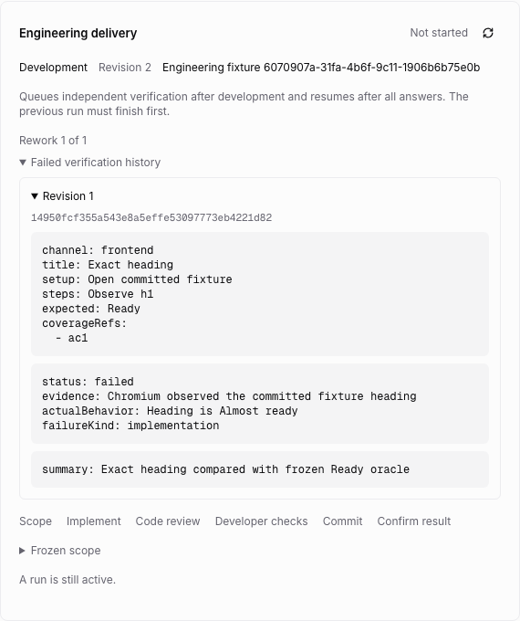
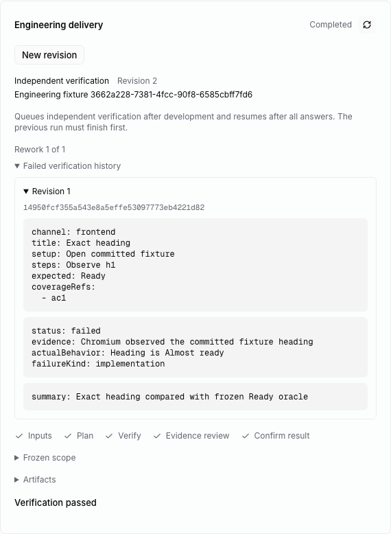

# Verification failure and bounded rework

The local fork can return an independently observed implementation failure to
development and recheck the resulting commit. New configurations expose an
**Automatic rework limit**, defaulting to three additional development rounds
when development and automatic continuation are enabled. The accepted range is
0–10; zero disables rework. CLI configurations opt in with `max_reworks` plus
`auto_continue: true` and a separate developer. Existing contracts remain at zero.

## Failure decisions

Only a completed, validated independent verification conclusion enters this
decision. A task exit or development's check receipt cannot trigger it.

| Conclusion or condition | Result |
| --- | --- |
| Implementation failure within the authorized budget | Create a new development generation and queue it after all existing issue runs finish |
| Specification failure, including mixed specification/implementation failures | Stop for specification review; do not send it to development |
| Same failed scenarios/attribution/normalized actual behavior and same code tree as the previous failed round | Stop for human review |
| Rework budget exhausted, even if code changed | Stop for human review |
| Automatic continuation/development/rework not authorized | Retain the failed report for manual action |
| Environment or inconclusive observation | Keep the existing blocked verification checkpoint; resolve runtime input before concluding |

Stagnation compares committed tree content, frozen source content, failed
scenario keys, attribution, and normalized actual behavior. Commit messages,
empty commits, UUIDs, and revision counters do not count as implementation
progress. Evidence wording alone is not a new observation. This is a deterministic
comparison of recorded facts, not a proof that an agent's semantic judgment is
correct. The absolute budget bounds changing failures as well.

## Generations and evidence

The failed draft remains completed with its actual commit, plan, observations,
review, run identity, and events. The host records the failure decision and,
when authorized, inserts the next execution revision in one SQLite transaction.
The root revision identifies the human-frozen scope and budget. An automatic
execution revision copies that scope and guidance without changing its oracles;
its developer starts from the failed delivery commit, including in worktree mode
where the registered checkout may still be at its original HEAD.

The new developer draft has no inherited claims, review, or selected checks.
Each failed scenario becomes a host-supplied recovery source, referencing the
original verification draft/key and expected result. Development must provide
recovery resolutions as well as fresh implementation claims, review, current
captured checks, and a clean scoped commit. Old command receipts remain attached
to the previous draft and cannot serve as new checks.

Independent verification then gets a new draft bound to the new commit. It
retains every frozen scenario, including previously passing scenarios and risks
added during execution. It starts in execution with no old results or evidence
review. Existing scenarios stay immutable; newly found risks can be appended.
Old human question history remains inactive; a new question requires a new answer.
Only a fresh current passed conclusion can satisfy the issue completion gate.

The shared issue panel shows the round/budget, stop reason, and prior failed
reports with their commits and observations. Before an unstarted generation is
queued, a human can freeze a replacement configuration. Stopped specification,
stagnation, or budget cases require human action; the [forward analysis chain](analysis.md) is connected, while automatic
specification-failure reanalysis and the system arbitration agent remain pending. An explicit new human configuration
starts a new root and budget; it does not erase stored prior revisions.

## Verification and limits

`application-rework.test.ts` covers failed-to-passed rework, fresh development
evidence, retained plans with cleared observations, empty-commit stagnation,
budget exhaustion, specification stops, explicit policy validation, storage
reopen, worktree commit selection, and settlement of a persisted terminal draft
after a crash before its host transition. The existing native coordinator still
checks lifecycle, membership/invocation, project/runtime mapping, and unfinished
issue tasks before queue admission.

`e2e/engineering-rework.spec.ts` uses the running scheduler, Go API, native CLI,
worker/SQLite, actual Git commits and command checks, and Chromium observations.
It records a real fixture mismatch, observes automatic development dispatch,
implements the corrected heading with fresh receipts, observes verifier dispatch,
rechecks the retained plan, and completes the issue only after a fresh pass. UI
captures show the retained failure and the passed recheck. Runtime claims are
owned fixture metadata; no installed agent CLI or model is executed.

The SQLite transition is separate from native task admission and filesystem
effects. This does not establish a cross-database transaction, external-effect
deduplication, or complete failure arbitration. Requirement planning, specification-failure reanalysis,
final review, remaining chains, other provider receipt adapters, and real
business/provider acceptance remain required for the full migration.
