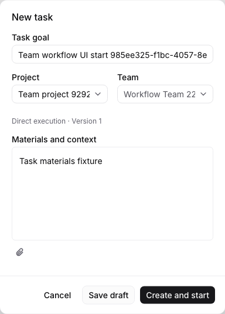
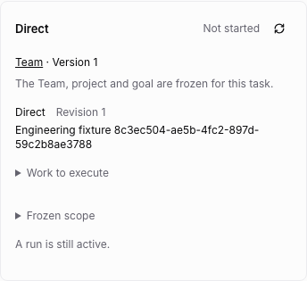
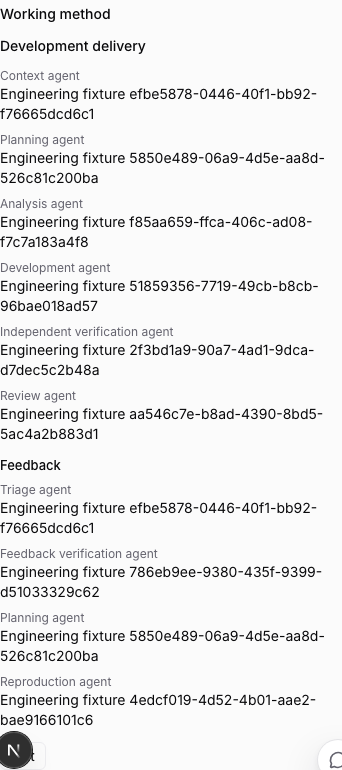
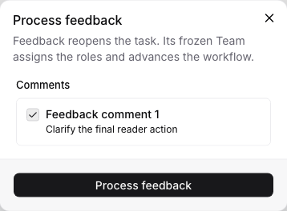
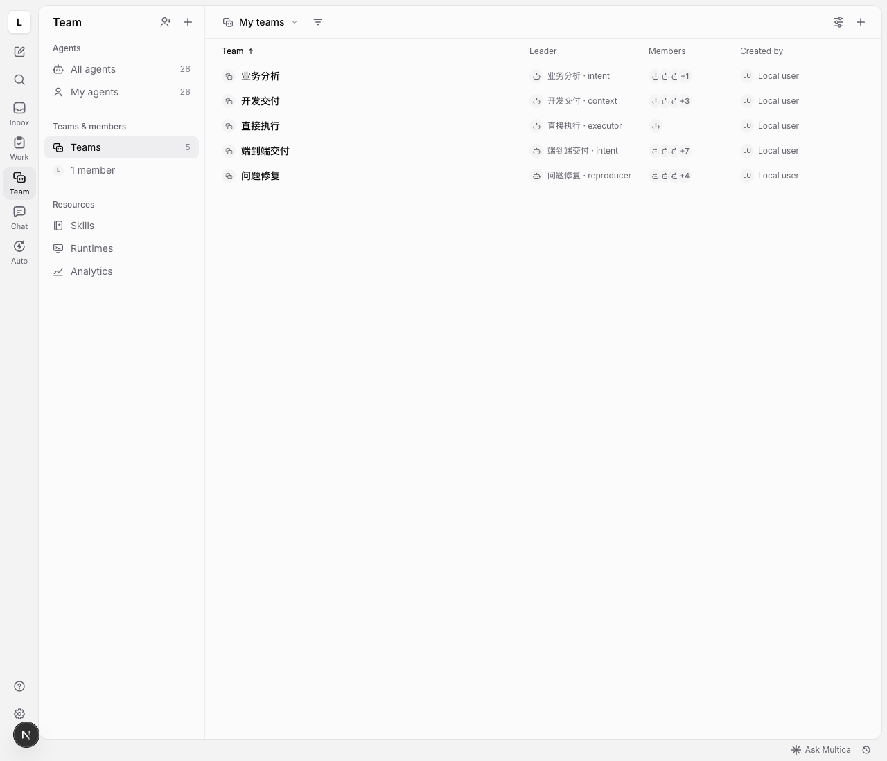
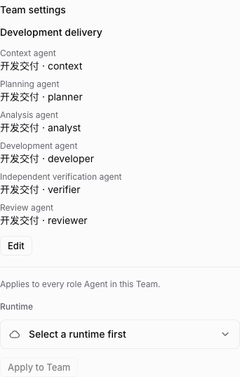
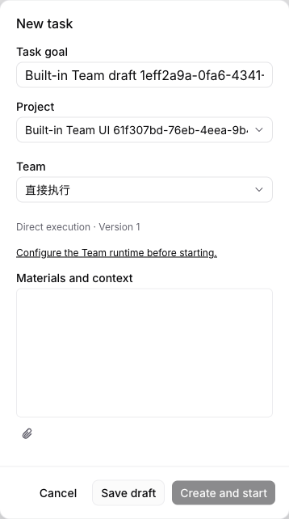

# Team-owned workflows

The agreed interaction is **task → Team → predefined workflow → role Agents**.
A task supplies its goal and project; the Team supplies its working method.
Users do not select a workflow or individual stage Agents on each task.
Projects retain repository/runtime resources.

## Current delivery goal

Ship five actual built-in Teams in the confirmed local single-user deployment:
Direct execution, Business analysis, End to End delivery, Development delivery
and Bug fix. They appear without creating a Squad, choosing a template or
setting a workflow. Each owns a predefined workflow, independent role Agents
and balanced policy with two reworks. A missing runtime is configured once on
the Team; tasks select only their Team, goal, project and materials.

Keep native Squad IDs and permissions as the underlying Team identity, with no
extra user-facing entity. Preserve existing Team edits and frozen task versions.
The built-in Team entry and controlled create/start browser acceptance are
connected. Continue migration by accepting complete Team task lifecycles, then
feedback, human intervention, recovery and historical/cutover requirements. Do not treat protocol initialization
tests as evidence of an already delivered built-in Team list.

## Built-in Teams in local mode

With local authentication and engineering enabled, local login initializes five
real native Teams and their independent native role Agents. Existing local
sessions receive the same initialization when their owner opens the Team list.
The IDs are stable per workspace and workflow; retries and simultaneous browser
entries do not duplicate Teams. Bootstrap creates only missing identities and
initial definitions, preserving names, archived state and saved configuration.
It does not create runs, discover provider CLIs or choose a runtime implicitly.
Other workspaces and deployments with engineering disabled are unchanged.

Each built-in Team already has a versioned definition and appears in the task
selector before a runtime is bound. Its workflow stays fixed; Team managers can
edit roles and policy in Team settings. The same settings provide one runtime
choice for all its role Agents, including optional Feedback roles, through the
ordinary authorized Agent update API. A failed update shows completed role count
and preserves the selection for retry; updates are sequential, not an atomic
multi-Agent transaction. Missing or archived role Agents cannot be made ready by
this control. Each later task start still performs normal native authorization
and project/resource validation.

The task form allows saving a draft with an unbound Team, displays a link to that
Team's settings, and disables initial start while any configured role lacks a
runtime. A bound runtime is not proof of online capacity, a project repository
mapping or successful execution; the existing start checks remain authoritative.

## Definitions and task snapshots

Multica's native Squad is the Team identity. Its leader, Agent membership and
management permissions remain authoritative. `GET/PUT /api/squads/{id}/engineering`
reads or saves its versioned workflow definition. Only an authenticated human
who can manage the Squad may save; required role Agents must be active native
members (including the leader). Machine credentials cannot manage definitions.

Definitions select Direct, Business Analysis, End to End, Develop or Bug Fix,
with their required independent role Agents, decision policy and bounded rework
budget. They contain no task goal, project ID or repository directory. Team
settings are shared by Web and Desktop through the Team settings section. Invalid or missing response data never becomes a configured Team.

The private worker stores immutable versions in `engineering_team_profile`.
Optimistic revision checks reject stale edits. Its `team-bind` operation freezes
one selected version, project, authenticated initiating human and authoritative
task input in `engineering_team_binding`. Identical retries reuse the snapshot;
changing those values requires an explicit new execution/replanning design.
Later Team edits do not rewrite existing task snapshots. Team-management
credentials cannot invoke task commands, and task credentials cannot configure
Teams or bind tasks.

## Task entry and execution

When engineering is enabled, the shared Web/Desktop create dialog asks for the
native task goal, project, materials and a configured Team. Workflow names are
read-only previews. Save draft creates Backlog without execution; Create and
start creates the native task and calls
`POST /api/issues/{id}/engineering/team-start` with an empty JSON object. A draft
can start from its task page after promotion to an allowed open project status.
A failed start keeps the saved task available for retry instead of creating a
second task. Uploads keep the native coordinated-upload gate and attachment IDs.

The authenticated host derives the goal from the native title/description,
resources from the project, and roles/policy from the Team. It verifies native
membership, role invocation rights and one canonical local repository/execution
mode. The worker freezes the snapshot before initializing the selected existing
workflow. Repeated starts reuse it, including after later Team edits. Pre-existing
engineering work must be reconciled before it can become a Team task.

Task detail shows the frozen Team revision, existing workflow progress,
artifacts, questions and results. It hides per-task workflow/Agent configuration,
unit-delivery authorization and final-review role selection for Team work.
The native API rejects those configuration endpoints for Team-owned tasks too.
Frozen goals/materials render read-only, project selection is locked, and issue
updates reject changing the root Team, project or goal. New facts belong in
comments; changing the task scope currently requires a new task rather than an
implicit replan.

Develop and Bug Fix derive their managed delivery policy and final reviewer
from the snapshot. Context and (for bugs) reproduction gates remain mandatory;
completed plans dispatch Team publication, native child completion and independent
final review through the established host proof paths. The ordinary native queue
cannot add an unrelated Agent or generic Squad leader run to Team-owned work.
Stable continuation task IDs preserve repeat-start behavior. Agent permissions
and native project/goal scope are revalidated before continuation.

Project status workflows still constrain allowed columns, but cannot silently
replace a Team task's assignment with a column handler. Archiving a configured
Team preserves its task/autopilot identity instead of transferring its tasks to
the leader. New starts reject archived Teams; existing frozen continuations
retain their original roles and still require current Agent/human authority.
Tasks predating a Team's first workflow definition are not automatically adopted.

## Team Feedback

End to End, Develop and Bug Fix Teams can explicitly enable Feedback and assign
its triager, independent verifier, forward planner and reproducer in Team
settings. These roles must be invocable native Team Agents. All four stay
separate from delivery analysis/development/Test; the feedback verifier is also
separate from report review, triage, planning and reproduction. The forward
planner and reproducer differ. Context/planning Agents may be explicitly reused
where those protocol boundaries allow it; no role is inferred on a task.

The entire optional policy is frozen with the task's Team version. Later Team
edits or disabling Feedback do not replace an existing task's roles. A task
whose frozen version has no Feedback policy cannot acquire the current Team's
policy implicitly. Existing standalone executions remain standalone even after
their Squad later receives a Team workflow definition.

Against a valid report, the task's Process feedback dialog selects only native
comments. Its API takes comment IDs and checkpoints without Agent fields. The
host derives both capture roles from the frozen policy, retains native comment
versions, and reopens Done through the existing lifecycle guard. Supplying
per-task feedback roles is rejected. The worker independently checks the frozen
roles and original human principal.

After triage, a persisted Team continuation authorizes forward work using that
same policy. Go validates the current batch/version, original principal,
project visibility, native children, Agent invocation rights and resources.
Defect groups receive the frozen reproducer before planning; other forward
groups go to planning directly. Retries reuse the saved work policy. Existing
managed delivery, independent per-comment verification, report correction and
fresh final review/reading gates remain in force. No per-task role picker or
second authorization form is needed for a Team's predefined feedback workflow.

## Verification and remaining boundary

The built-in Team browser scenario reads the real native list and all five
stored definitions, checks their visibility at wide/narrow sizes, checks that
the predefined workflow is already set and locked, and creates a native Backlog
task by selecting an existing built-in Team. Missing runtime keeps initial start
disabled and links to Team settings. Empty runtime settings link to runtime
connection. This scenario does not bind a real provider or start the built-in
Teams; fixture-owned Teams separately exercise runtime-backed task start.

Controlled browser acceptance covered Team settings save/reload, task creation
with only project/Team selection, saving a draft without a queue entry, starting
the draft, direct create/start, frozen task progress, and wide/narrow layouts.
The native database/worker test verifies one non-leader queue entry, start retry,
configuration-override rejection, frozen scope update rejection, and preservation
through Team archival. Kernel tests cover all five preset initializations,
version freeze, legacy-task routing and Develop/Bug Fix context/reproduction/plan
handoffs after reopening storage. Added Team Feedback protocol scenarios run real
context/planning, managed delivery and independent Test, final report, capture
and triage gates before testing frozen-role forward authorization. Native
adapter tests cover comment capture, role-override rejection and automatic
planning/reproduction scope. Browser acceptance saves/reloads actual Team
settings; its feedback dialog uses a controlled report response to verify
layout and comment-only request shape, not a native full-lifecycle claim.
Shared component regression tests and Web/Desktop type checks cover the changed
entry points.

These tests use controlled native fixtures, never a real provider. Full Team
lifecycle acceptance for every preset, installed Desktop, independent Mobile,
explicit replanning and historical/in-flight work migration remain separate
work. Legacy task configuration remains available
for execution that has not adopted Team ownership. Independent Admin repair and
shared-repository ownership retain their own migration requirements.

