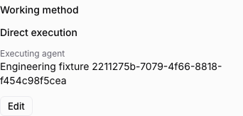

# Team-owned workflows

The agreed interaction is **task → Team → predefined workflow → role Agents**.
A task supplies its goal and project; the Team supplies its working method.
Users do not select a workflow or individual stage Agents on each task.
Projects retain repository/runtime resources.

## Definitions and task snapshots

Multica's native Squad is the Team identity. Its leader, Agent membership and
management permissions remain authoritative. `GET/PUT /api/squads/{id}/engineering`
reads or saves its versioned workflow definition. Only an authenticated human
who can manage the Squad may save; required role Agents must be active native
members (including the leader). Machine credentials cannot manage definitions.

Definitions select Direct, Business Analysis, End to End, Develop or Bug Fix,
with their required independent role Agents, decision policy and bounded rework
budget. They contain no task goal, project ID or repository directory. Team
settings are shared by Web and Desktop through the Squad detail working-method
section. Invalid or missing response data never becomes a configured Team.

The private worker stores immutable versions in `engineering_team_profile`.
Optimistic revision checks reject stale edits. Its `team-bind` operation freezes
one selected version, project, authenticated initiating human and authoritative
task input in `engineering_team_binding`. Identical retries reuse the snapshot;
changing those values requires an explicit new execution/replanning design.
Later Team edits do not rewrite existing task snapshots. Team-management
credentials cannot invoke task commands, and task credentials cannot configure
Teams or bind tasks.

## Integration boundary

The settings UI/API and private snapshot operation are implemented and tested.
The task creation/start path has **not yet** been converted to Team-owned
execution. Existing issue-level engineering configuration controls and generic
Squad leader delegation still exist. A saved Team definition alone does not
change that routing or establish the complete interaction redesign.

The next integration must derive the goal from the native task, repository from
its project, and role bindings/policy from the selected Team snapshot. It must
suppress generic Squad leader delegation for that workflow-owned run, preserve
authorization/completion guards and queued native role identities, and connect
all supported workflow presets. The task UI must expose progress, artifacts and
human decisions instead of another per-task role/workflow configuration form.
Running snapshots must retain their original Team version when membership or
working methods change. Team archival/reassignment needs explicit handling for
running work.

Historical data migration and the remaining independent repair pipeline retain
their own acceptance requirements. They are not completed by Team settings.

## Current settings verification

Controlled browser acceptance saved a Direct workflow on a native Team, checked
the returned member binding/revision, reloaded the page and checked both wide and
narrow layouts. The fixture used a native test Agent and did not start a provider.
The task entry conversion is outside this scenario's evidence.

