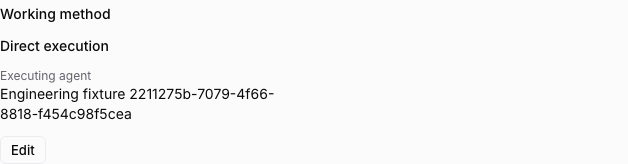
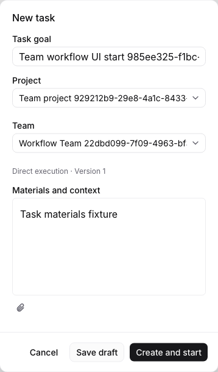

# Team-owned workflows

The agreed interaction is **task → Team → predefined workflow → role Agents**.
A task supplies its goal and project; the Team supplies its working method.
Users do not select a workflow or individual stage Agents on each task.
Projects retain repository/runtime resources.

## Definitions and task snapshots

Multica's native Squad is the Team identity. Its leader, Agent membership and
management permissions remain authoritative. `GET/PUT /api/squads/{id}/engineering`
reads or saves its versioned workflow definition. Only an authenticated human
who can manage the Squad may save; required role Agents must be active native
members (including the leader). Machine credentials cannot manage definitions.

Definitions select Direct, Business Analysis, End to End, Develop or Bug Fix,
with their required independent role Agents, decision policy and bounded rework
budget. They contain no task goal, project ID or repository directory. Team
settings are shared by Web and Desktop through the Squad detail working-method
section. Invalid or missing response data never becomes a configured Team.

The private worker stores immutable versions in `engineering_team_profile`.
Optimistic revision checks reject stale edits. Its `team-bind` operation freezes
one selected version, project, authenticated initiating human and authoritative
task input in `engineering_team_binding`. Identical retries reuse the snapshot;
changing those values requires an explicit new execution/replanning design.
Later Team edits do not rewrite existing task snapshots. Team-management
credentials cannot invoke task commands, and task credentials cannot configure
Teams or bind tasks.

## Task entry and execution

When engineering is enabled, the shared Web/Desktop create dialog asks for the
native task goal, project, materials and a configured Team. Workflow names are
read-only previews. Save draft creates Backlog without execution; Create and
start creates the native task and calls
`POST /api/issues/{id}/engineering/team-start` with an empty JSON object. A draft
can start from its task page after promotion to an allowed open project status.
A failed start keeps the saved task available for retry instead of creating a
second task. Uploads keep the native coordinated-upload gate and attachment IDs.

The authenticated host derives the goal from the native title/description,
resources from the project, and roles/policy from the Team. It verifies native
membership, role invocation rights and one canonical local repository/execution
mode. The worker freezes the snapshot before initializing the selected existing
workflow. Repeated starts reuse it, including after later Team edits. Pre-existing
engineering work must be reconciled before it can become a Team task.

Task detail shows the frozen Team revision, existing workflow progress,
artifacts, questions and results. It hides per-task workflow/Agent configuration,
unit-delivery authorization and final-review role selection for Team work.
The native API rejects those configuration endpoints for Team-owned tasks too.
Frozen goals/materials render read-only, project selection is locked, and issue
updates reject changing the root Team, project or goal. New facts belong in
comments; changing the task scope currently requires a new task rather than an
implicit replan.

Develop and Bug Fix derive their managed delivery policy and final reviewer
from the snapshot. Context and (for bugs) reproduction gates remain mandatory;
completed plans dispatch Team publication, native child completion and independent
final review through the established host proof paths. The ordinary native queue
cannot add an unrelated Agent or generic Squad leader run to Team-owned work.
Stable continuation task IDs preserve repeat-start behavior. Agent permissions
and native project/goal scope are revalidated before continuation.

Project status workflows still constrain allowed columns, but cannot silently
replace a Team task's assignment with a column handler. Archiving a configured
Team preserves its task/autopilot identity instead of transferring its tasks to
the leader. New starts reject archived Teams; existing frozen continuations
retain their original roles and still require current Agent/human authority.
Tasks predating a Team's first workflow definition are not automatically adopted.

## Verification and remaining boundary

Controlled browser acceptance covered Team settings save/reload, task creation
with only project/Team selection, saving a draft without a queue entry, starting
the draft, direct create/start, frozen task progress, and wide/narrow layouts.
The native database/worker test verifies one non-leader queue entry, start retry,
configuration-override rejection, frozen scope update rejection, and preservation
through Team archival. Kernel tests cover all five preset initializations,
version freeze, legacy-task routing and Develop/Bug Fix context/reproduction/plan
handoffs after reopening storage. Shared component regression tests and Web/
Desktop type checks cover the changed entry points.

These tests use controlled native fixtures, never a real provider. Full Team
lifecycle acceptance for every preset, installed Desktop, independent Mobile,
Team-owned Feedback role policy, explicit replanning and historical/in-flight
work migration remain separate work. Legacy task configuration remains available
for execution that has not adopted Team ownership. Independent Admin repair and
shared-repository ownership retain their own migration requirements.

